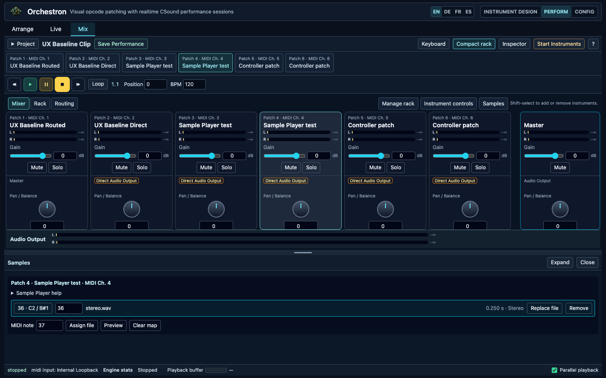
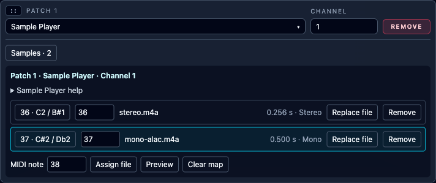
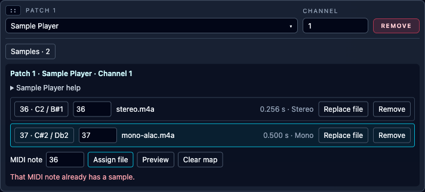
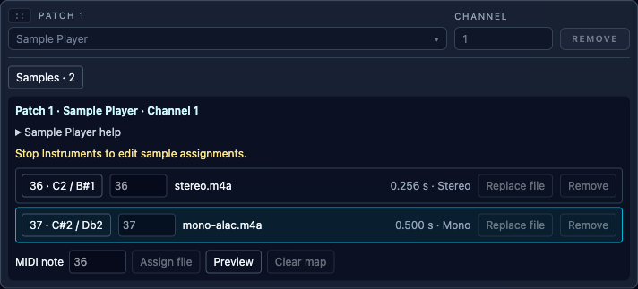

# Sample Player

**Navigation:** [Up](performance.md) | [Previous](instrument_rack_and_engine_transport.md) | [Next](audio_mixer_and_routing.md)

Use the Sample Player to make a drum kit, trigger sound effects, or play recordings from a
keyboard or sequencer. Each MIDI note can play one mono or stereo WAV, MP3 or M4A at its original
pitch and speed. Notes with no assignment are silent.

## Assign and hear a sample

1. In **Perform → Mix → Rack**, choose **Add Instrument**, search for **Sample Player** and select its name to create the slot.
2. Open **Samples**. Enter a MIDI note from **0 to 127** and choose **Assign file**.
3. Select a row and choose **Preview** to hear it through the instance’s mixer routing.
4. To change a note number, type in its number field and press Enter or leave the field.

The note number identifies the note (60 is C4). **Stop preview** or closing the panel ends only the preview.
You can preview during playback or while the performance is stopped.

In Perform, select the kit in **Compact rack** and choose **Samples**. Check the patch number and MIDI channel above the map before changing a file. Two copies of one kit can use different files on the same note. Switching instances or closing Samples ends the current preview. Stop Instruments to edit the assignments.

While a sample plays, use its channel’s **Mute**, **Solo**, gain and insert **Bypass** to compare what you hear. In a full-pane editor these controls sit above the sample map. Choosing Master in **Mixer channel** keeps the kit and its preview selected. [Mix a performance](audio_mixer_and_routing.md#mix-a-performance)

Use **Replace file**, **Remove**, or **Clear map** to update the assignments. A failed or
canceled upload keeps the previous file. An occupied note number keeps its original assignment.

Choose **Stop Instruments** to make changes. Stopping only the arranger leaves assignments
locked. You can still inspect and preview mapped notes while the instrument engine runs.

## Use separate maps

Two instances of the same patch can play different samples for the same note.
Use **Add Instrument** and select the same Sample Player patch to start another empty map on a new MIDI channel.
Changing one instance’s map leaves the other instance alone.

Choosing a different patch clears that instance’s map. If the existing patch was edited in
Instrument Design and no longer has its Sample Player node, the assignments remain. Restore
the node or clear the map before playing or exporting.

To build a sampler in **Instrument Design**, add the `sample_player` opcode from the catalog
and connect both channels to your stereo outputs. You can also insert audio processing between
the opcode and the outputs. Use one Sample Player node in the main graph of a MIDI instrument,
outside If and Switch cases and separate from MIDI Legato. Assign samples in **Perform**.

## Play and export

Releasing a key does not cut the sample, and repeated hits can overlap. Brief fades at both ends
soften clicks. An explicit Stop, a lane being muted or suppressed by Solo, or **Panic** can cut
sounding samples. Normal pad changes and the natural end of an arrangement let tails finish.
A note restarted after a seek begins its sample from the first frame.

**Save Performance** retains each map and its audio. A native performance ZIP includes the
original uploads for editing on another installation.
**Export CSD (MIDI)** and **Export CSD (SCORE)** include playback audio for the selected instruments.
Keep the extracted files together and run the command in the included README from the
extracted folder. Renders include sample tails that extend beyond the song range.

Use mono or stereo WAV, MP3 or M4A (AAC or Apple Lossless) files of up to two minutes each, subject to the audio storage
limit. Use the regular mixer controls for volume, balance and effects. Sample Player uses
single renderer playback if **Parallel playback** is enabled.

**Navigation:** [Up](performance.md) | [Previous](instrument_rack_and_engine_transport.md) | [Next](audio_mixer_and_routing.md)
