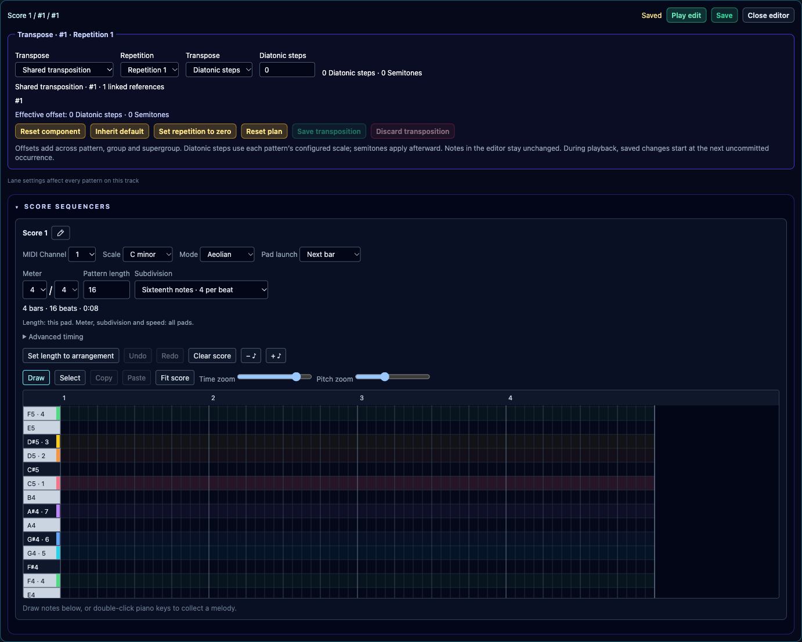

# Score Sequencers

Score Sequencers hold long, polyphonic passages with an independent start, duration
and velocity for every note. Choose **Add track → Score** in the arranger, add a clip and a pattern, then
double-click the pattern to open its Score editor. Match its MIDI channel to a
rack instrument. A new pattern starts at four local bars.

The **?** button at the top right opens the standard help modal in English,
German, French or Spanish, following the GUI language. Use it from the Score pattern editor.

Select a Score clip and use **Remove track** to remove its track.

## Draw and edit notes

The vertical keyboard stays on the left while the score scrolls. All 128 MIDI
pitches remain available. Coloured rows and keyboard markers show scale degrees;
notes outside the selected mode remain editable. Each pad remembers its own
scale and mode. Changing these controls updates guidance without moving notes.

- **Play a key:** press and hold a vertical piano key to audition its pitch at velocity 100 through this device's MIDI channel. Release to stop; focused keys also respond to Enter and Space. The instrument engine starts automatically if needed, without starting the score or arranger, and remains running until stopped. Releasing during startup cancels that pending note. Collapsing, leaving the editor or losing focus releases held keys.
- **Collect a melody:** double-click a key to append a quarter note at velocity 100 to the edited pad. Start at zero if empty, otherwise exactly after the latest note end, including hidden notes. Subdivision is ignored: a quarter occupies one local beat in /4 or two in /8. Pattern length stays fixed; increase it first if the whole note will not fit. Each insertion is one Undo action and selects and reveals the new note. Insertion works without audio. Collect pitches, then arrange their rhythm and duration.
- **Draw:** drag empty space to set a note's start and duration. Drag a note to move it; drag either edge to resize it. Creation, movement and resizing snap to the selected subdivision. Changing subdivision leaves existing notes in place.
- **Select:** drag a rectangle around notes. Cmd/Ctrl-click adds or removes a note from the selection; dragging selected notes moves them together.
- **Copy / Paste:** copy selected notes and paste them at the last clicked score position. The clipboard is shared between this device's pads.
- **Note properties:** right-click a note, or select it and press **Shift+F10**. Set velocity or add a chord from **In scale** or **Out of scale**. Added tones inherit the root's start, duration and velocity, and remain independently editable. Identical pitch/start/duration combinations are not added again.
- **Time zoom**, **Pitch zoom**, and **Fit score** control the view. Scroll to reach other pitches or later passages. The white playhead follows audible time on the sounding pad, independently of editing another pad.
- **− ♪ / + ♪** transpose notes by a scale degree using the same calculation as melodic sequencers. Hold Shift for an octave. **Copy pad to** copies the whole score, length, scale and mode to another pad.

Keyboard commands apply within the focused editor: Delete/Backspace removes
selected notes; Cmd/Ctrl+A selects all; Cmd/Ctrl+C/V copies/pastes; Cmd/Ctrl+Z
undoes and Cmd/Ctrl+Shift+Z redoes. Escape or a cancelled pointer gesture discards
the note preview. A completed drag is one undo action.

The score has a separate 25-action undo/redo history per pad. Selection,
clipboard, history, zoom and scroll survive collapse and view switches during
the session. New, Load and Import reset this temporary editor state. These
settings are not stored in a performance or its arranger history.

<!-- pagebreak -->

## Duration and hidden notes

The grid ends exactly at Pattern length. Drawing a note, dragging its right edge,
or moving it can place its end exactly on that boundary. Resizing its left edge
keeps the end fixed. Blank space after the boundary is outside the pattern and
does not create notes.

**Pattern length** accepts 1–8,192 whole local beats and displays bars, beats and
elapsed time at the current tempo and playback speed. Meter, subdivision and
speed apply to all pads in the device; length applies only to the selected pad.
Global tempo remains quarter-note based. See [Sequencer timing](sequencer_timing.md).

**Set length to arrangement** uses the other arranged lanes and rounds up to a
whole local beat. An arrangement exceeding the score capacity is rejected.

Shortening keeps the music at its original positions. Notes starting beyond the
end are silent, and releases crossing the end are clipped during playback. The
**Hidden notes** count includes both cases. Expand the length to recover them.
**Trim hidden notes** removes later notes and cuts crossing notes to the current
end; Undo restores the original material.

Each pad supports 10,000 stored notes, including hidden notes. A performance
supports 16 Score Sequencers and 50,000 score notes in total. Operations exceeding
these limits are rejected as a whole. General save and export size limits also
apply.

## Transport and arrangement

Use the arranger's **Play**, **Pause** and **Stop** controls for the song. **Play edit** auditions the open Score pattern while retaining the current song cursor. During song playback it replaces that track while the other tracks continue. **Stop edit** restores the arrangement at its current position.

Use clips, groups and supergroups to arrange Score patterns on the timeline. Edit partial passages inside the Score editor. Pattern duration and clip duration are independent; trimming a clip retains the notes beyond its window.

Different pitches sustain independently. A repeated pitch retriggers it and replaces its previous release. Starting, seeking or returning from an audition inside a sustained note retriggers only its remaining duration.

Live edits apply at a render boundary. Unchanged sounding notes remain held;
changed durations update their releases; deleted or moved notes release. New
attacks behind the playhead wait for the next occurrence. A failed preparation
keeps the playing version and the edited draft. Shortening a finite arrangement
past its cursor stops it without rewinding.

## Save, export and authoring

Save/Load, clone, autosave and native JSON/ZIP bundles preserve saved Score patterns, note identities, hidden material, timing and arrangement. Save the pattern draft before saving or exporting the performance.

Both [MIDI and SCORE exports](performance_import_export.md) use the live event
scheduler, including remaining-duration notes at an export range's start.
Score notes can also feed arpeggiators through their input MIDI channel.

For CLI authoring, use `edit add-score-sequencer --spec score-track.json` with
the dedicated [Score Sequencer format](../../integrations/skills/orchestron-performance-creator/references/score_sequencer.md).
Existing composition-score inputs and `edit apply-score` keep their established
meaning.

<!-- pagebreak -->

## Clip transposition

The clip arranger supports [shared repetition transpositions and independent nested offsets](multitrack_arranger.md#transpose-clips-without-changing-notes). Saved settings are preserved by native bundles and both MIDI and SCORE CSD exports. Transposition uses performance format v25; older readers cannot safely edit it.

## Create a Score pattern in the clip arranger

Score patterns are edited directly from their clips in the [multitrack arranger](multitrack_arranger.md).

1. Choose **Add track → Score** and match its MIDI channel to a rack instrument.
2. Use the track's first pattern, or add another clip with the track's **+** or by double-clicking empty lane space.
3. For an empty clip, use its inline **+** / **Add content**, then **New pattern** to insert a Score pattern. Existing definitions can also be adopted as linked patterns.
4. Double-click the nested pattern box, or focus its name and press **Enter**. The Score sequencer opens in context with the clip breadcrumb and draft controls.
5. Hold piano keys to try pitches and double-click to collect quarter notes; then move and resize notes. The **?** opens the same multilingual help.
6. Use **Play edit** to audition the pattern. Choose **Edit linked pattern** or **Create variation here** before editing shared content. The chosen scope remains visible, and Save applies it without another scope question. A local save creates a variation only when content changed. Save the pattern before saving or exporting the performance to include these edits.

Pattern length and the clip window are independent. Saving musical edits keeps
the clip boundaries; use **Fit clip to content** when the clip should match its
content.
