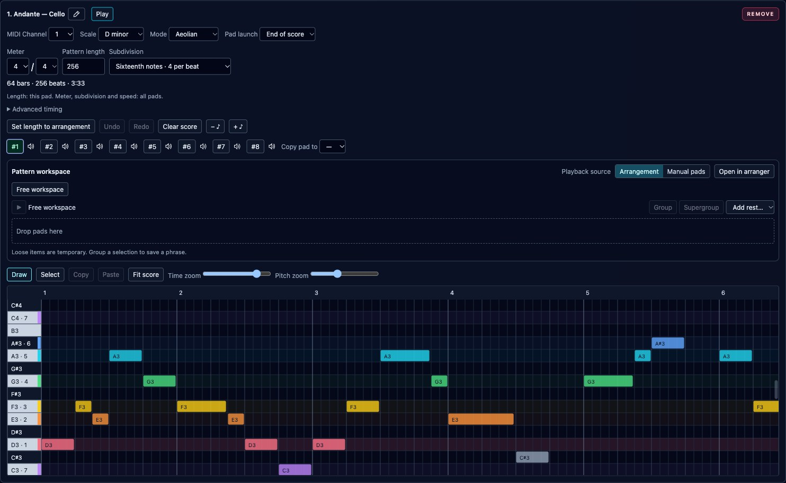

# Score Sequencers

Score Sequencers hold long, polyphonic passages with an independent start, duration
and velocity for every note. Add one in **Perform → Score Sequencers**, choose its
MIDI channel to match a rack instrument, and draw notes in the score. Each device
has eight pads; a new pad starts at four local bars.

The rose **Remove** button sits at the right end of each device header, alongside
its name and Play/Stop controls, matching the other sequencers.

## Draw and edit notes

The vertical keyboard stays on the left while the score scrolls. All 128 MIDI
pitches remain available. Coloured rows and keyboard markers show scale degrees;
notes outside the selected mode remain editable. Each pad remembers its own
scale and mode. Changing these controls updates guidance without moving notes.

- **Draw:** drag empty space to set a note's start and duration. Drag a note to move it; drag either edge to resize it. Creation, movement and resizing snap to the selected subdivision. Changing subdivision leaves existing notes in place.
- **Select:** drag a rectangle around notes. Cmd/Ctrl-click adds or removes a note from the selection; dragging selected notes moves them together.
- **Copy / Paste:** copy selected notes and paste them at the last clicked score position. The clipboard is shared between this device's pads.
- **Note properties:** right-click a note, or select it and press **Shift+F10**. Set velocity or add a chord from **In scale** or **Out of scale**. Added tones inherit the root's start, duration and velocity, and remain independently editable. Identical pitch/start/duration combinations are not added again.
- **Time zoom**, **Pitch zoom**, and **Fit score** control the view. Scroll to reach other pitches or later passages. The white playhead follows audible time on the sounding pad, independently of editing another pad.
- **− ♪ / + ♪** transpose notes by a scale degree using the same calculation as melodic sequencers. Hold Shift for an octave. **Copy pad to** copies the whole score, length, scale and mode to another pad.

Keyboard commands apply within the focused editor: Delete/Backspace removes
selected notes; Cmd/Ctrl+A selects all; Cmd/Ctrl+C/V copies/pastes; Cmd/Ctrl+Z
undoes and Cmd/Ctrl+Shift+Z redoes. Escape or a cancelled pointer gesture discards
the note preview. A completed drag is one undo action.

The score has a separate 25-action undo/redo history per pad. Selection,
clipboard, history, zoom and scroll survive collapse and view switches during
the session. New, Load and Import reset this temporary editor state. These
settings are not stored in a performance or its arranger history.

## Duration and hidden notes

**Pattern length** accepts 1–8,192 whole local beats and displays bars, beats and
elapsed time at the current tempo and playback speed. Meter, subdivision and
speed apply to all pads in the device; length applies only to the selected pad.
Global tempo remains quarter-note based. See [Sequencer timing](sequencer_timing.md).

**Set length to arrangement** uses the other arranged lanes and rounds up to a
whole local beat. An arrangement exceeding the score capacity is rejected.

Shortening keeps the music at its original positions. Notes starting beyond the
end are silent, and releases crossing the end are clipped during playback. The
**Hidden notes** count includes both cases. Expand the length to recover them.
**Trim hidden notes** removes later notes and cuts crossing notes to the current
end; Undo restores the original material.

Each pad supports 10,000 stored notes, including hidden notes. A performance
supports 16 Score Sequencers and 50,000 score notes in total. Operations exceeding
these limits are rejected as a whole. General save and export size limits also
apply.

## Pads, transport and arrangement

**Play** starts this device's selected source. **Manual pads** starts the editing
pad from its beginning. While running, clicking another pad selects it for
editing and queues playback: orange marks the queue, cyan marks the sounding
pad. **Pad launch → Next bar** switches at the next local bar or the current
score's earlier end. **End of score** waits for the score boundary. A later
selection replaces the pending one, and the next pad starts from its beginning.
Stopped devices and devices using **Arrangement** only change their editing pad
when a pad is clicked.

Drag pads into the [pattern workspace](pattern_pads_and_pad_looper.md) to assemble reusable
phrases, or into the [multitrack arranger](multitrack_arranger.md) to place them in
song order. Each score pad is one indivisible occurrence: range selection expands
to include the whole score. Edit a partial passage inside the Score editor.
Groups, variations, arranger undo/redo, lane mute/solo and speaker previews use
the same controls as other sequencers.

The multitrack arranger also appears when the performance contains only Score
Sequencers; each score device has its own lane.

Different pitches sustain independently. A repeated pitch retriggers it and
replaces the previous release. Starting, seeking or returning from a preview
inside a sustained note retriggers only its remaining duration. Independently
running Manual pads keep their phase through arranger seeks and Play/Stop.

Live edits apply at a render boundary. Unchanged sounding notes remain held;
changed durations update their releases; deleted or moved notes release. New
attacks behind the playhead wait for the next occurrence. A failed preparation
keeps the playing version and the edited draft. Shortening a finite arrangement
past its cursor stops it without rewinding.

## Save, export and authoring

Save/Load, clone, autosave and native JSON/ZIP bundles preserve all eight scores,
note IDs, hidden material, timing, source and arrangement. Current performances
write version 21 and app state writes version 4; older supported versions load
with no Score Sequencers. The native bundle envelope stays version 1.

Both [MIDI and SCORE exports](performance_import_export.md) use the live event
scheduler, including remaining-duration notes at an export range's start.
Score notes can also feed arpeggiators through their input MIDI channel.

For CLI authoring, use `edit add-score-sequencer --spec score-track.json` with
the dedicated [Score Sequencer format](../../integrations/skills/orchestron-performance-creator/references/score_sequencer.md).
Existing composition-score inputs and `edit apply-score` keep their established
meaning.
