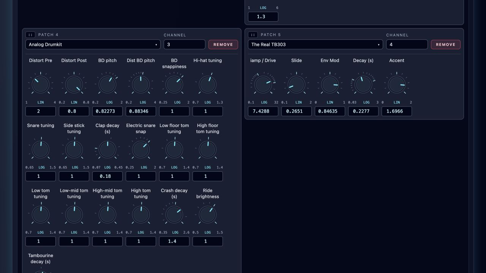
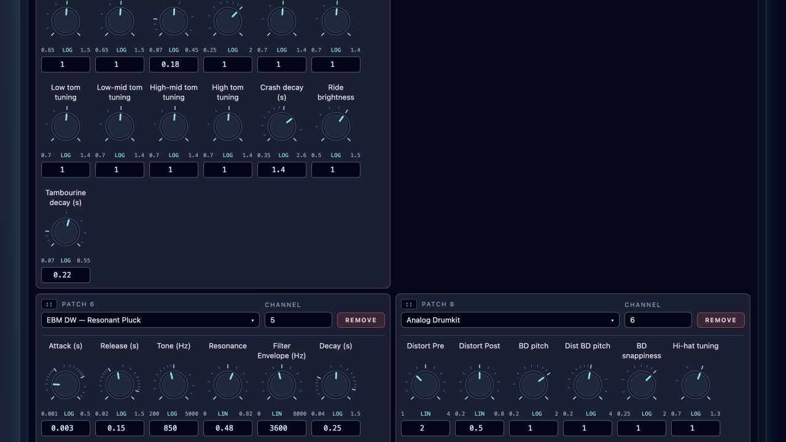
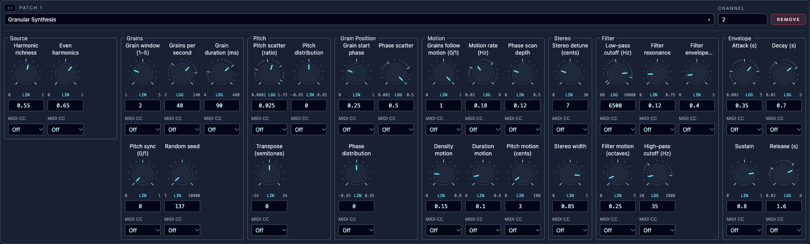

# Supplied Instruments

**Navigation:** [Up](supplied.md) | [Previous](supplied.md) | [Next](../instrument_design/steel_string_waveguide.md)

These instruments respond to MIDI notes. Import and save one, add it to a performance, then use a piano roll or sequencer on its assigned channel. Each guide gives the playing behavior and controls specific to that sound.

## Instrument guides

<!-- manual-contents:start -->
- [Physical Steel-String Guitar](../instrument_design/steel_string_waveguide.md)
- [Ambient Techno Instruments](../instrument_design/ambient_techno.md)
- [HSB Mono](../instrument_design/hsb_mono.md)
- [Enough and Logan](../instrument_design/enough_and_logan.md)
- [Goa Trance FM Lead](../instrument_design/goa_trance_fm_lead.md)
<!-- manual-contents:end -->

For processors that receive audio from another instrument, see [Standard Effects](../performance/standard_effects.md).

## More instrument examples

The [Analog Drumkit](../../examples/instruments/analog_drumkit/README.md) has shared
**BD snappiness** for notes 35/36, shared **Hi-hat tuning** for 42/46, and **Snare
tuning** for 38. Each defaults to **1**, preserving the original sound. Side stick
37, clap 39, electric snare 40, toms 41/43/45/47/48/50, crash 49, ride 51 and
tambourine 54 each have one individual characteristic control. New notes adopt changes.

### Granular Synthesis

[Download Granular Synthesis](../../examples/instruments/Granular_Synthesis.orch.instrument.json). This instrument
exposes 30 settings for its two `grain3` streams: harmonic source shaping, grain
windows, density and duration, pitch and phase scatter, random distributions,
internal motion, filters, ADSR and stereo width. Pan and level use the rack mixer.
The controls are grouped into Source, Grains, Pitch, Grain Position, Motion,
Stereo, Filter and Envelope. Settings apply to new notes; held notes continue their initialized internal modulation.
Import its native bundle in Instrument Design, then add it to a performance to explore the grouped controls.

Minimoog Monophonic also groups its 40 controls by oscillator, modulation, noise,
filter, envelopes and performance settings. Ambient Wavetable Cloud groups its
14 controls into Wavetable, Motion, Stereo, Envelope and Output & MIDI. These
group names only organize the rack; sounds, controller IDs and saved settings
remain unchanged.

**Navigation:** [Up](supplied.md) | [Previous](supplied.md) | [Next](../instrument_design/steel_string_waveguide.md)
