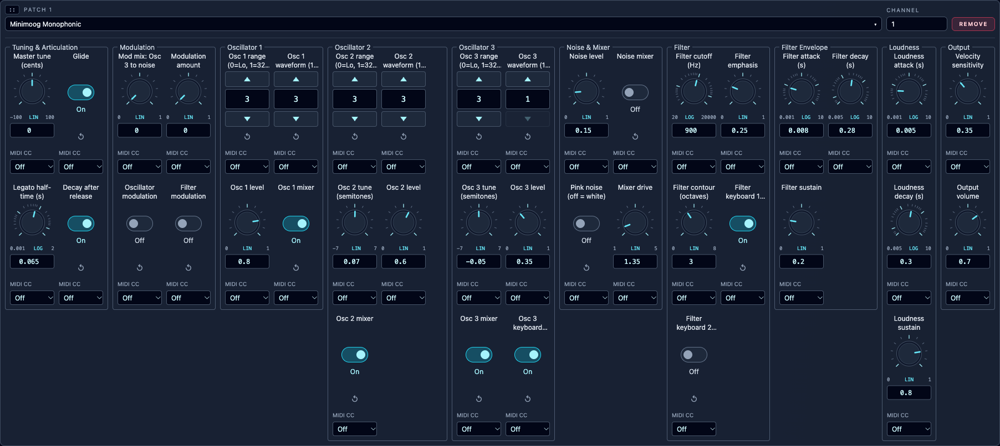

# Minimoog Monophonic

[Native instrument](../Minimoog_Monophonic.orch.instrument.json) ·
[Editable graph](minimoog_monophonic.patch.json)

A sample-free, monophonic synthesizer inspired by the original Minimoog Model D:
three oscillators, a white/pink noise mixer, a nonlinear 24 dB/octave ladder
filter, separate filter and loudness contours, and oscillator-3/noise modulation.
Its 40 performance controls include integer selectors and on/off switches.

Select **Minimoog Monophonic** in the instrument library, add it to the Perform
rack, and route **Stereo Output → Master**. On another installation, import the
native instrument above. Start with MIDI notes 36–84. Both output channels carry
the same centered mono sound; add stereo effects in the rack if desired.

## Legato and glide

Touching or overlapping notes share one voice, both envelopes and oscillator
phase. The newest held note wins; releasing it returns to the most recently
held note. A gap starts a new phrase with a fresh attack and the new pitch
immediately, including when the previous phrase is still releasing.

**Glide** enables pitch slides inside a connected phrase. **Legato half-time (s)**
sets the time to cover half the remaining interval: 0.065 seconds by default,
with a range of 0.001–2 seconds. After about five half-times the slide has covered
97% of the interval. Pitch is smoothed in octaves, so equal ascending and
descending intervals have matching timing. Turning Glide off preserves legato
envelopes but makes pitch changes immediate. This control does not add a grace
period between separated notes.

Rack controls are read at **phrase start**. Release all keys, then play again
to hear a changed setting. Orchestron's optional CC 1–50 mappings retain that
same phrase-start behavior. Note velocity remains live within the phrase.

## Performance controls

The rack groups the 40 controls into **Tuning & Articulation**, **Modulation**,
**Oscillator 1**, **Oscillator 2**, **Oscillator 3**, **Noise & Mixer**, **Filter**,
**Filter Envelope**, **Loudness** and **Output**. Each oscillator keeps its
level and mixer switch alongside its tuning and waveform controls.



| Section | Controls | Range / default |
| --- | --- | --- |
| Tuning | Master tune | −100…+100 cents / 0 |
| Legato | Glide; Legato half-time | On; 0.001–2 s / 0.065 s |
| Release | Decay after release | On; each contour uses its own Decay time |
| Modulation | Osc 3 → noise mix; Amount | 0–1 / 0; 0–1 / 0 |
| Modulation destinations | Oscillator modulation; Filter modulation | Both Off |
| Oscillators 1–3 | Range; Waveform | Range 3 (8 ft); waves 3, 3, 1 |
| Oscillators 2–3 | Tune | −7…+7 semitones / +0.07, −0.05 |
| Oscillators 1–3 | Level; Mixer switch | 0–1 / 0.8, 0.6, 0.35; all On |
| Oscillator 3 | Keyboard control | On |
| Noise | Level; Mixer switch; Pink noise | 0–1 / 0.15; Off; Off (white) |
| Mixer | Drive | 1–5 / 1.35 |
| Filter | Cutoff; Emphasis; Contour | 20–20,000 Hz / 900; 0–1 / 0.25; 0–8 octaves / 3 |
| Filter tracking | Keyboard 1; Keyboard 2 | 1/3 On; 2/3 Off; together = full tracking |
| Filter contour | Attack; Decay; Sustain | 0.001–10 s / 0.008; 0.005–10 s / 0.28; 0–1 / 0.2 |
| Loudness contour | Attack; Decay; Sustain | 0.001–10 s / 0.005; 0.005–10 s / 0.3; 0–1 / 0.8 |
| Output | Velocity sensitivity; Volume | 0–1 / 0.35; 0–1 / 0.7 |

Range positions: **0 = Lo, 1 = 32 ft, 2 = 16 ft, 3 = 8 ft, 4 = 4 ft, 5 = 2 ft**.
Lo is six octaves below 8 ft. With Osc 3 Keyboard Control off, its reference is
C4, so Lo produces approximately 4.1 Hz before Osc 3 tuning.

| Waveform position | Oscillators 1–2 | Oscillator 3 |
| --- | --- | --- |
| 1 | Triangle | Triangle |
| 2 | Triangle/saw blend | Reverse saw |
| 3 | Saw | Saw |
| 4 | Square (50% pulse) | Square (50% pulse) |
| 5 | 25% pulse | 25% pulse |
| 6 | 12.5% pulse | 12.5% pulse |

The oscillators are band-limited. The triangle/saw blend approximates the
characteristic intermediate waveform. Emphasis controls ladder resonance;
Contour raises cutoff by the selected number of octaves at envelope peak.
Filter tracking is referenced to C3. Cutoff is bounded to 20–20,000 Hz.
The output stage gently saturates strong signals, keeping even extreme mixer
settings below full scale without hard clipping.
Disabling Decay after release closes both contours in 5 ms to avoid clicks.
Velocity sensitivity 0 gives the original-style fixed loudness response.

## Starting sounds

All recipes start from the patch defaults; leave unlisted controls unchanged.

| Sound | Changes |
| --- | --- |
| Rounded bass | Cutoff 250 Hz; Contour 3; Filter decay 0.15 s; Filter sustain 0; Osc 3 mixer Off; Glide Off |
| Singing lead | Cutoff 1,600 Hz; Emphasis 0.35; Loudness sustain 1; Legato half-time 0.1 s |
| Classic vibrato | Osc 3 range 0; Osc 3 keyboard Off; Osc 3 mixer Off; Oscillator modulation On; Amount 0.06 |
| Filter wah | Osc 3 range 0; Osc 3 keyboard Off; Osc 3 mixer Off; Filter modulation On; Amount 0.4 |
| Noise sweep | All oscillator mixer switches Off; Noise mixer On; Noise level 0.7; Pink noise On; Filter attack 1 s; Contour 6 |

Oscillator 3 continues to modulate when its mixer switch is off. Noise modulation
is likewise independent of the Noise mixer switch. Modulation Amount acts as
the modulation-wheel setting; it is a performance control, not a hardwired live
CC1 input. Assign a CC in the rack if wanted. Oscillator modulation affects
oscillators 1 and 2. Filter modulation spans up to three octaves in either
direction; oscillator modulation spans up to six semitones.

This is an editable synthesis approximation, not a circuit-exact emulation.
It uses Orchestron's last-note priority rather than the original hardware's
low-note priority, and does not emulate external audio/CV inputs, pitch-wheel
hardware or drift. Oscillator-3 modulation is sampled at the engine control
rate; very fast audio-rate modulation depends on the engine's control block size.
The modern additions are mixer drive, velocity sensitivity and timed legato.

## Reproduce and validate

From the repository root:

```sh
.venv/bin/python -m examples.instruments.minimoog_monophonic.build
.venv/bin/python -m examples.instruments.minimoog_monophonic.render
```

The builder writes the editable graph and native instrument. The renderer uses
the real graph compiler, mixer routing and Csound engine, then saves stereo
floating-point WAVs, the note events and numerical results under
`output/minimoog_monophonic/`. It does not change the library or any performance.
`seed.yaml` is the validated subtractive starting specification; the custom
builder adds the complete Minimoog controls and phrase logic.

Validation covers all 40 controllers at their endpoints, all six waveforms on
each isolated oscillator, maximum mixer levels, noise and modulation, silence,
velocity response, clipping, both channels and release tails. Dedicated probes
check glide half-time, shared envelopes, held-note fallback and separate-phrase
reset through both MIDI and SCORE delivery at control blocks of 1 and 32 samples.
The final Mel and log-STFT plots are inspected separately; this does not replace
subjective listening.

The [validation summary](validation.json) records 118 successful renders with
finite stereo samples and no clipping (largest absolute sample 0.701). Mel and
log-STFT images for the default and ten representative variations were visually
inspected. No subjective listening pass was performed. Frontend and Docker
frontend builds both passed.

References: [Moog Model D manual](https://cdn.inmusicbrands.com/Moog/Model%20D/Minimoog_Model_D_Manual.pdf),
[Csound vco2](https://csound.com/docs/manual/vco2.html),
[moogladder](https://csound.com/docs/manual/moogladder.html),
[portk](https://csound.com/docs/manual/portk.html), and
[Orchestron monophonic legato](../../../documentation/instrument_design/midi_legato.md).
