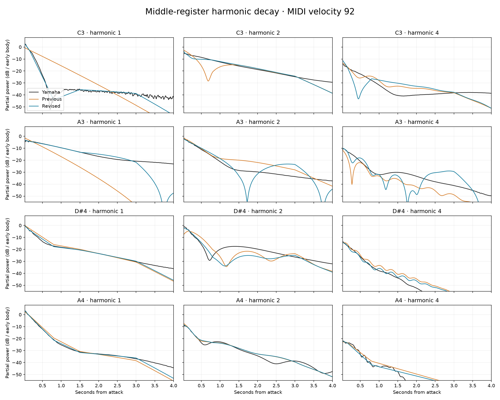

# Piano Additive Synthesis — design and development

**Piano Additive Synthesis** is a playable hybrid physical/additive piano for Orchestron. It combines Csound's `prepiano` string model with synthetic `adsyn` harmonic profiles, two retained partial oscillators, and a separate attack/contact model. The spelling “Additive” preserves the requested instrument name.

The acoustic reference is **Alexander Holm's Salamander Grand Piano V3, recorded from a Yamaha C5**, distributed under [CC BY 3.0](https://creativecommons.org/licenses/by/3.0/). The [reference library](https://github.com/sfzinstruments/SalamanderGrandPiano) supplied measurements of harmonic balance, velocity response and decay. The instrument contains **generated breakpoint data, not Yamaha audio samples**.

This documentation captures the design after the **C3–B4 harmonic/decay refinement**. C4 means MIDI 60 throughout. It explains both the current instrument and the experiments that led to it; historical measurements are identified by revision.

## Use the current instrument

- [Current instrument bundle](../Piano_Additive_Synthesis.orch.instrument.zip): import in Instrument Design.
- [Current “From Bass to Bells” demo](../../performances/Piano_Additive_Synthesis_Demo.orch.zip): import in Perform. It retains the same two-hand arrangement, 110 notes, velocities and timing used throughout the later comparisons.
- [Current reproducible generator](../../../tools/piano_additive/build_profiles.py) and [generator notes](../../../tools/piano_additive/README.md).

The `build_profiles.py`, `fit.json`, `velocity_basis.json` and demo ZIP already located **beside this README** are earlier conversion snapshots, preserved as historical material. In particular, the local demo ZIP is the initial additive version, not the current middle-refined version linked above. Use the current generator under `tools/piano_additive/` to reproduce the latest instrument.

## Read the design

| Document | What it explains |
| --- | --- |
| [Architecture and mixing](design/architecture.md) | What `prepiano`, `adsyn`, retained oscillators and contact modes contribute; the actual summing equation; why this is a hybrid |
| [Registers, velocity and controls](design/registers-and-controls.md) | Keyboard regions, interpolation, all ten performance controls, preservation boundaries and approximations |
| [Synthetic HETRO and reproduction](design/hetro-and-reproduction.md) | File construction, normalization, time/frequency scaling, compact velocity bases and deterministic rebuilding |
| [Yamaha reference and analysis method](analysis/reference-and-method.md) | Recordings, attribution, velocity-layer mapping, onset alignment, time/frequency resolution, fitting and caveats |
| [Development history](analysis/development-history.md) | Sustain/attack work, the “sinusoidal” diagnosis, harmonic correction, complexity reduction, additive conversion and bass study |
| [Current results and validation](analysis/results.md) | Middle-register results, independent checks, limitations, preservation tests and rendered-demo plots |
| [Evidence index](analysis/evidence-index.md) | Local plots, numeric results, provenance, hashes and how to read older figure labels |

## Current design at a glance

The physical layer supplies responsive strings and excitation. The additive layer supplies measured partial levels and independent decay trajectories that the physical model alone did not reproduce. A separate, restrained attack/contact layer supplies transient and body features; it is not a substitute for sustained harmonics.

The instrument retains one `prepiano`, two `oscil3` and five `expsega` nodes. Its 51 HETRO files are selected by register and blended by pitch and velocity. There are 156 editor nodes including branch/result markers; this is not the number of simultaneously active oscillators. Rubbers and rattles are disabled. All ten original performance controls remain.

The latest change refines existing harmonics within **C3–B4 only**. In the tested renders, A0–B2 and C5–C8 are bit-identical to the preceding bass-enriched version. The native instrument ZIP is 169,703 bytes; the combined uncompressed graph document and HETRO payloads are 770,896 bytes.

| Latest Yamaha comparison, 100 ms–4 s | Before | After |
| --- | ---: | ---: |
| 32 fitting cases | 3.240 dB | 0.813 dB |
| 16 recorded velocity layers excluded from fitting | 3.104 dB | 0.833 dB |
| Eight transposed pitch proxies excluded from fitting | 3.229 dB | 1.968 dB |

These are reference-energy-weighted partial-level errors, **not listening scores**. Two pitch proxies regress; fine beating, room response and physical/additive interference still differ from the Yamaha. The [results](analysis/results.md) document includes the full qualifications and per-note table.

*Velocity 92. Black: Yamaha; orange: preceding bass-enriched instrument; blue: current instrument. Curves show selected partial bands, not total note loudness.*

The documentation includes 18 preserved plots and accompanying analysis records in subfolders. It does not require the original local `output/` directory to read the reports or inspect the evidence. Numeric fitting data and the production generator remain in their existing repository locations. No instrument or performance is changed by this documentation package.
