# How the instrument was built

[Documentation home](../README.md) · [Reference and method](reference-and-method.md) · [Current results](results.md)

This is a sequence of design decisions, not a set of interchangeable benchmarks. “Current”, “previous” and “revised” inside archived plots refer to the revision being investigated at that stage. Only the final section describes the present middle-refined instrument.

## 1. Establish a playable physical piano

The starting brief was a `prepiano` instrument with MIDI pitch and velocity, meaningful performance controls, and no rubber or rattle preparations. The physical string model provided a useful starting response. Ten controls exposed decay, detune, stiffness, loss, hammer mass/hardness/strength, strike position, release and output level.

A short two-hand performance, “From Bass to Bells”, supplied a consistent musical test: chords and melody across bass, middle and upper registers with varied velocities. Later revisions kept its notes and arrangement fixed so a changed performance would not disguise a changed instrument.

Initial upper-register work first extended sustain, then reduced it when sample comparisons showed it was too long. Attack work then exposed another mismatch: excessive noisy hammer energy, particularly in the later high-register passage. This led to a more structured contact/body response rather than simply making the transient louder. The numeric evidence archived here begins with the subsequent detailed attack and spectrum studies; these earlier listening requests are design history, not independently quantified experiments in this package.

## 2. Measure the first 25 ms—and discover that the problem lasts longer

The lower-register attack was still dull. The first-25-ms investigation compared Yamaha C2–C5 at four layers and used Iowa Steinway recordings as an independent cross-check.

For the then-current physical piano at velocity 92, the first-25-ms 1–8 kHz / 60–1000 Hz energy ratio was roughly 51 dB darker than Yamaha at C2, 44 dB at C3 and 39 dB at C4. These are ratios between frequency bands, **not overall loudness differences or recommended EQ boosts**. Similar deficits persisted into 25–150 ms, ruling out a missing click as the sole cause. The early model entered a smooth low-frequency oscillation too directly while lacking tonal upper structure.

The remedy therefore needed deterministic string harmonics and suitable amplitude evolution, rather than a large random-noise burst. Velocity already changed the spectrum, but from a much too-dark baseline and with the wrong progression.

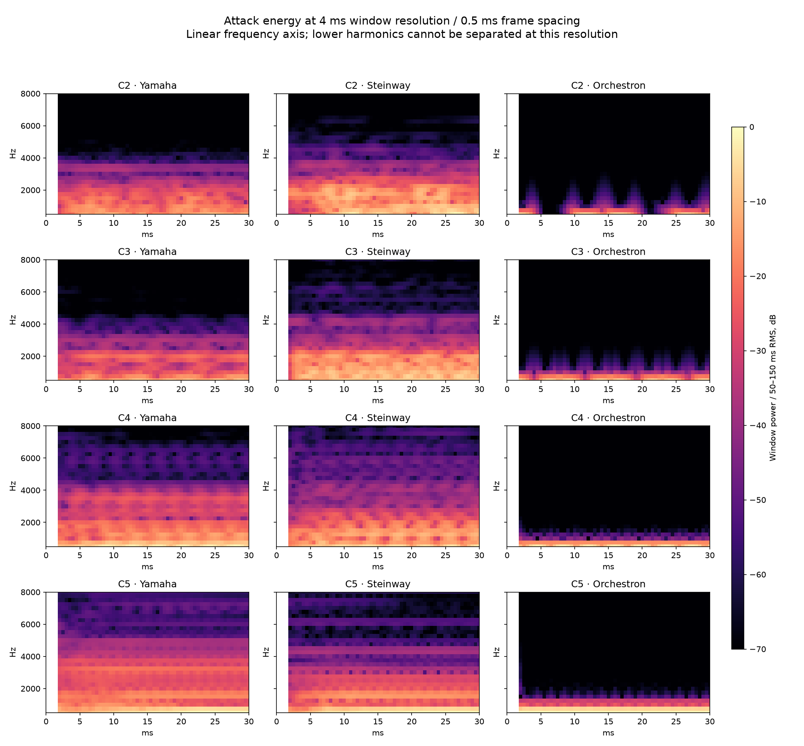

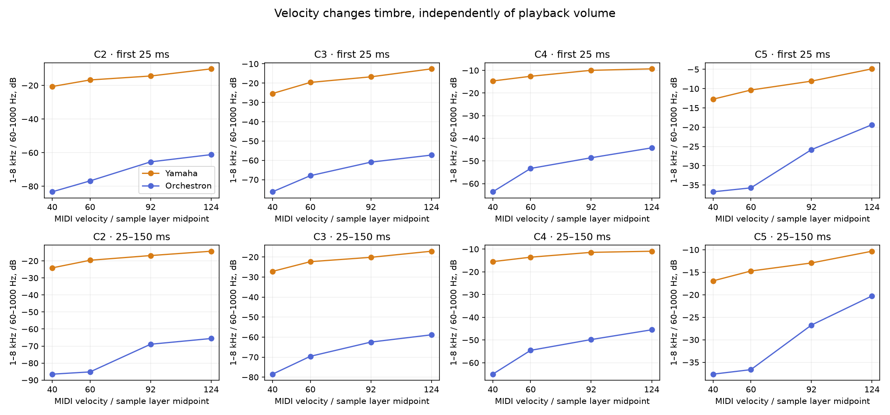

Records: [attack measurements](data/attack/measurements.json), [sources](data/attack/sources.json). See [method and attribution](reference-and-method.md) for the 25 ms resolution limits and the Steinway cross-check.

## 3. Explain the “sinusoidal” character with spectra over time

The next study tracked partial bands through more than four seconds. At C4/velocity 92, the old model placed about 92% of early measured power in the fundamental, compared with about 41% in Yamaha. The model had two resolved partial bands under that study's threshold, versus fifteen in Yamaha. At C2 the corresponding counts were six versus thirty-three. These are measurements of the **early physical version**, not the current additive piano.

The missing energy occupied specific tonal bands. It could not be supplied by noisy hammer texture. Partial decays also differed: Yamaha's low and high components did not all follow one uniform exponential relationship. Some low components faded faster, so the relative spectral centroid could rise even while total energy fell.

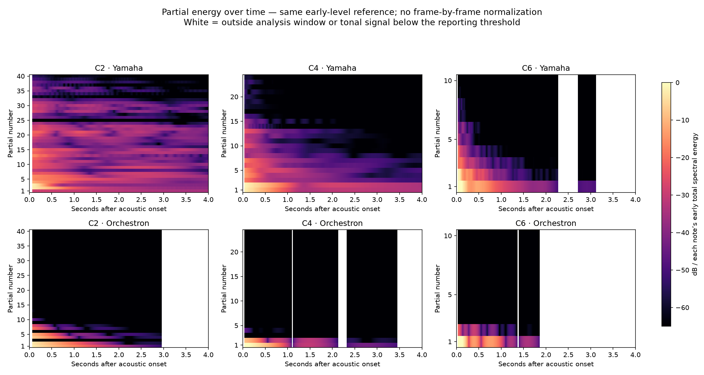

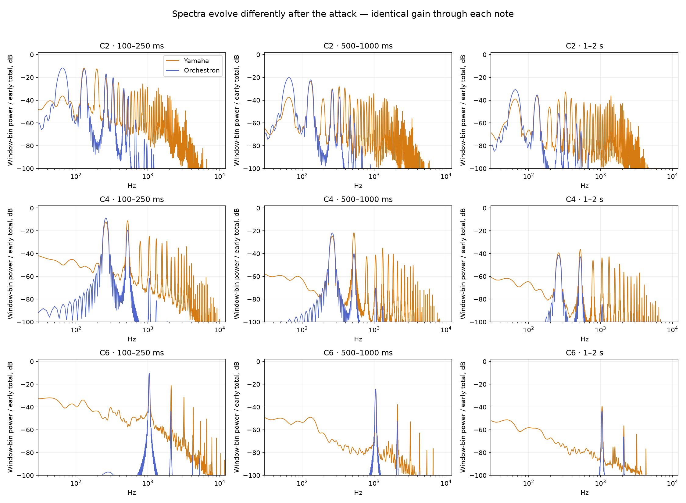

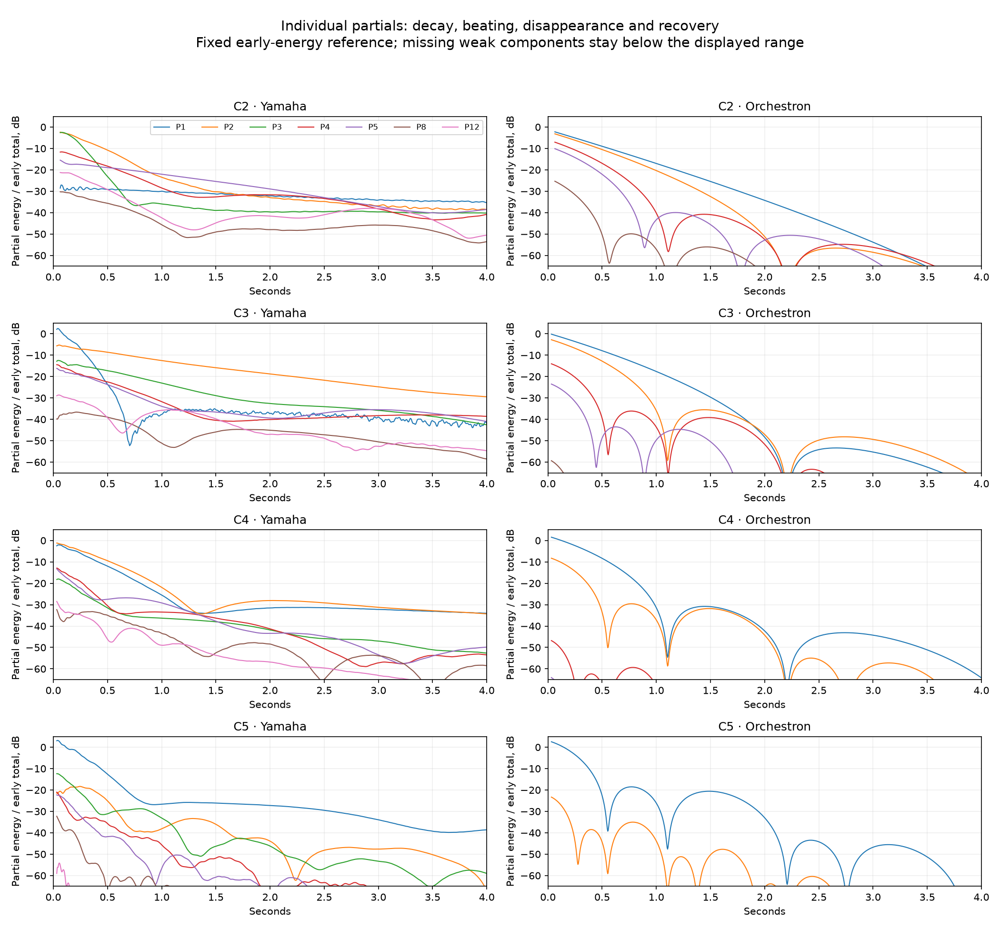

The symmetric detuned-string model also produced unusually regular cancellation/recovery. A diagnostic with detune set to zero removed those dips, confirming the mechanism, but did not restore the missing harmonics. Zero detune was therefore a diagnostic, not the final solution.

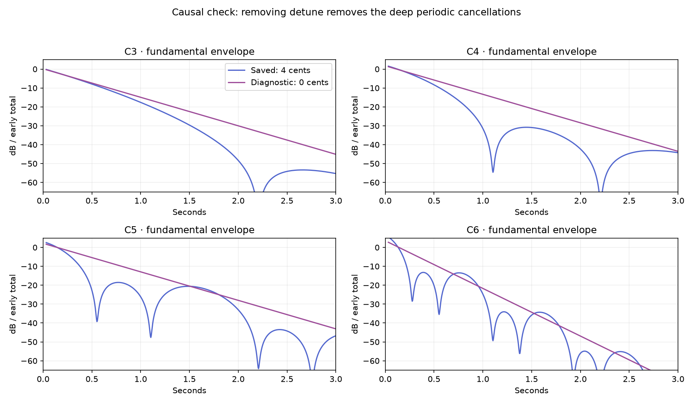

The uppermost keyboard needed different treatment. C7/C8 reference tones did not contain dozens of strong upper partials; lower-frequency body response and the trajectories of a few components mattered more. This argued against indiscriminately adding harmonics everywhere.

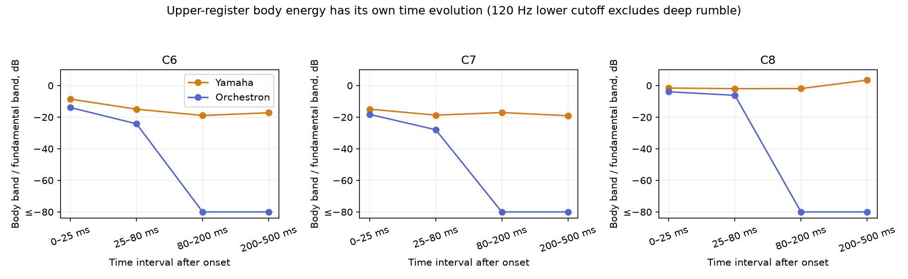

Records: [measurements](data/original_spectra/measurements.json), [partial table](data/original_spectra/partial_summary.csv), [calibration](data/original_spectra/calibration.json).

## 4. Add targeted harmonics, then reduce explicit graph complexity

A physical/additive revision supplied the missing spectral components with explicit `oscil3` oscillators and envelopes fitted against the Yamaha. It improved the sound, but the graph grew too large: the later pre-compaction instrument used 47 oscillators, 48 `expsega` envelopes and a roughly 1.18 MB native JSON export.

The compact revision retained 32 selected partial oscillators and 17 envelopes. Dominant lower partials kept individual envelopes; weaker upper partials shared trajectories. Linear splines replaced repeated nested interpolation. The export fell to 474,397 bytes. C4–G5 received denser reference anchors and tailored decay; G#5/A5/A#5 had the separate filtered-noise hammer component reduced by 18 dB. That number does not describe a reduction of the complete note attack.

In this revision's own velocity-92 C4–F#5 comparison, the mean partial error fell from 5.14 to 1.62 dB. Those figures use the compact study's normalization and note grid, not the latest middle study's metric configuration.

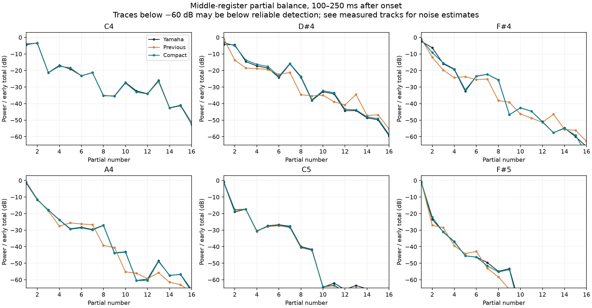

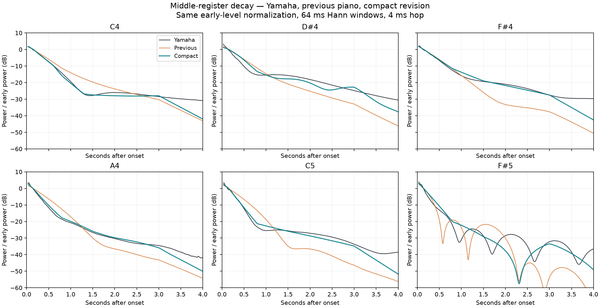

Records: [compact comparison](data/compact/comparison.json), [validation](data/compact/validation.json), [reference sources](data/compact/sources.json).

## 5. Move the harmonic bank into synthetic `adsyn` files

The next simplification replaced 30 explicit oscillators with register-specific synthetic HETRO files. The first additive version had 34 files, two retained oscillators and five `expsega` nodes. Partials 2 and 4 stayed explicit because replacing them changed phase-dependent interference with the strings and damaged the approved attack.

The whole keyboard was not represented by one transposed file. Multiple anchors capture register-dependent spectra, while nonnegative velocity fitting removes redundant stored layers. The F#1 anchor was retained after off-grid testing exposed a bass interpolation error. The conversion also restored independent trajectories for some weaker partials that had shared envelopes in the compact graph.

| Measurement | Compact explicit bank | Initial additive conversion |
| --- | ---: | ---: |
| `oscil3` | 32 | 2 |
| `expsega` | 17 | 5 |
| HETRO files | 0 | 34 |
| Editor nodes | 99 | 130 |
| Native graph document | 474,397 bytes | 282,820 bytes |
| Native instrument ZIP | Not the same export format | 92,371 bytes |
| Local eight-note, four-second SCORE render median | 2.575 s | 1.807 s |

More editor nodes were needed for conditional branches and results even though separate oscillator/envelope work fell. ZIP compression is not a measure of DSP cost. These render timings predate later revisions and exclude compilation; they are not a current polyphony guarantee.

The initial conversion largely preserved the previous spectral match: the seven-note C4–F#5 score remained about 1.617 dB on both versions. Across 45 additional note/velocity cases, maximum stage-level difference was 0.73 dB. This step primarily simplified the model; it did not by itself establish a large Yamaha fidelity improvement.

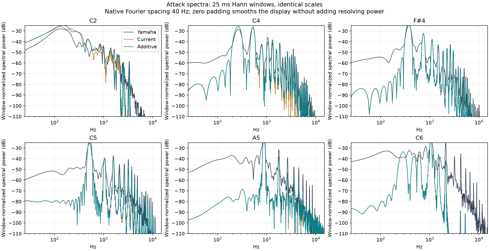

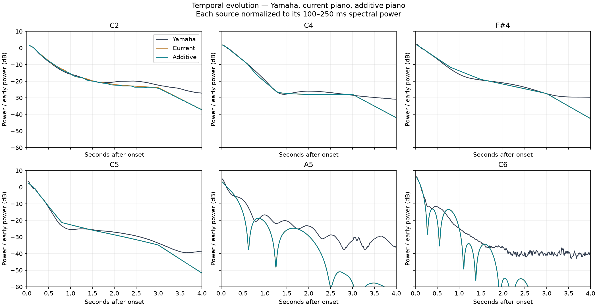

Records: [comparison](data/additive/comparison.json), [off-grid tests](data/additive/off_grid.json), [validation](data/additive/validation.json).

## 6. Test whether more partials help below C5

The harmonic-density experiment appended only missing components, preserving existing tracks, normalizations and graph structure. It compared partial-index ceilings 48, 64 and 80 over 33 note/velocity cases. These ceilings are not counts of oscillators in every file: weak components were omitted.

| Hard C1/C2 spectral error | Baseline | Through 48 | Through 64 | Through 80 |
| --- | ---: | ---: | ---: | ---: |
| Five-stage mean, velocity 124 | 2.9305 dB | 2.7378 dB | 2.7293 dB | 2.7291 dB |

Filling through 48 captured approximately 96% of the measured hard-bass improvement through 80. The sampled C3–A4 error barely changed. Almost all baseline absolute partial-power error in that experiment was in partial indices already represented by the instrument. The evidence favoured correcting existing harmonic trajectories in the middle, not uniformly increasing oscillator count.

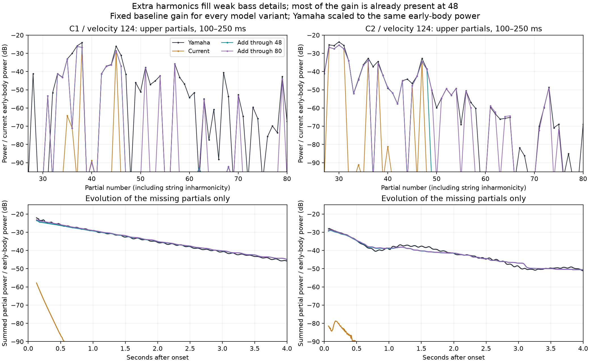

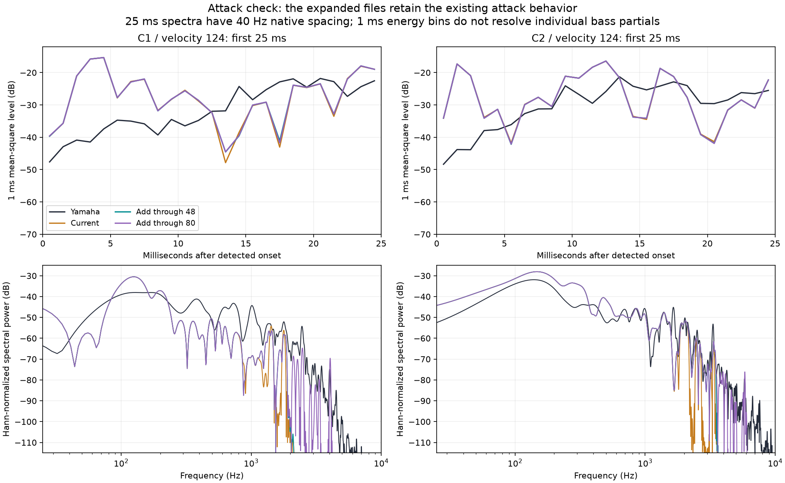

The adopted bass enrichment added 61 tracks across six C1/F#1/C2 files, selected through partial 48. It changed no graph nodes or original tracks and faded to zero at C3. The C3–C8 sweep was bit-identical in that bass-only revision. That preservation statement is historical: the subsequent middle change intentionally modifies C3–B4.

Records: [density summary](data/density/summary.json), [all comparisons](data/density/comparisons.json), [reference survey](data/density/reference_survey.json), [benchmark](data/density/benchmark.json), [adopted bass validation](data/bass/validation.json).

## 7. Refine the existing C3–B4 harmonics and decay

The current revision follows that conclusion. It uses eight middle anchors, four fitting velocities, denser HETRO time points, and independently adjusted existing-partial envelopes. It preserves the approved bass and C5-upward sound through separate branches and exact MIDI masks.

The fundamental/core and retained second/fourth harmonic envelopes were fitted together with the HETRO bank. A narrow change to the existing physical-core EQ reduces excess second-harmonic energy where added oscillators alone cannot correct it. Full/stem rendering accounts for phase interaction during updates. No new harmonic orders or `oscil3`/`expsega` nodes were added for this refinement.

Calibration error fell from 3.240 to 0.813 dB, with an improvement on recorded velocity layers excluded from fitting as well. Pitch-proxy results are mixed. The current model contains 51 files and 156 editor nodes; the instrument ZIP is about 170 KB. See [current results](results.md) for the detailed numbers, preservation tests and remaining limitations.
