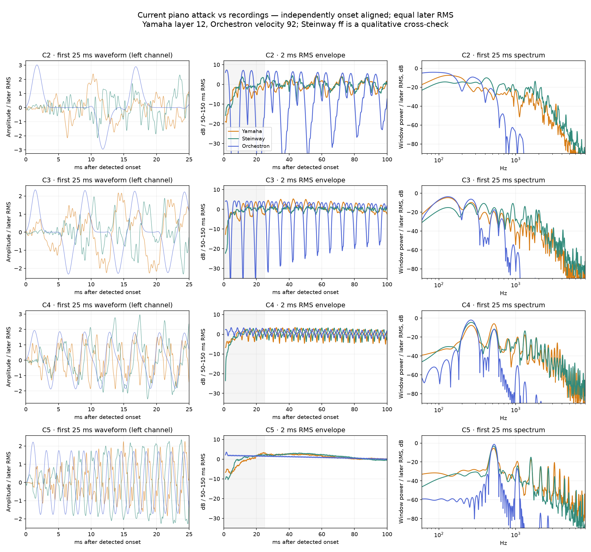

# Yamaha reference and analysis method

[Documentation home](../README.md) · [Development history](development-history.md) · [Current results](results.md)

## Reference and attribution

The primary reference throughout the harmonic work is **Salamander Grand Piano V3 by Alexander Holm**, a recording of a **Yamaha C5**, distributed under [Creative Commons Attribution 3.0](https://creativecommons.org/licenses/by/3.0/). Source: [sfzinstruments/SalamanderGrandPiano](https://github.com/sfzinstruments/SalamanderGrandPiano), the 48 kHz / 24-bit library. “Yamaha” in these reports means this particular recorded instrument, its tuning, voicing, microphones and room—not a universal specification for Yamaha pianos.

The plots and fitting values are derived from these recordings. Analysis transformations include independent onset alignment, level referencing, Fourier/partial-power analysis, local-background subtraction and, for explicitly labelled pitch proxies, resampling. The instrument contains no reference waveforms. No acoustic reference audio is redistributed in this documentation package.

The early attack study also used University of Iowa **Steinway model B** recordings performed by Evan Mazunik, from the [Iowa Musical Instrument Samples](https://theremin.music.uiowa.edu/MISpiano.html), as an independent comparison. Its pp/mf/ff labels do not map to exact MIDI velocities. Figures containing those curves retain the Steinway labels; they must not be described as additional Yamaha measurements.

Original sample URLs and SHA-256 hashes are archived for the [attack study](data/attack/sources.json), [original spectral study](data/original_spectra/sources.json), [compact revision](data/compact/sources.json), [density study](data/density/sources.json), and latest [middle fitting](data/middle/sources.json) / [holdouts](data/middle/holdout_sources.json). Machine-specific paths were made portable in these copies; source audio hashes and numeric results were retained.

## Notes, velocity and test conditions

C4 is MIDI 60. The usual fitting velocities 40, 60, 92 and 124 select Salamander layers v4, v8, v12 and v16 respectively. Those layers cover MIDI ranges 37–43, 57–64, 89–96 and 121–127 in the library mapping. Matching layer selection is not a measurement of equal hammer speed or calibrated acoustic loudness.

The original full-spectrum diagnosis compared C1–C8 at four velocities, plus A2/A4/A6 at velocity 92: 35 recorded and 35 rendered cases. Four further diagnostic renders varied detune. Later experiments deliberately changed their pitch grids and baselines; results from different grids are not directly interchangeable.

The current middle fit uses C3, D#3, F#3, A3, C4, D#4, F#4 and A4 at four velocities: **32 cases**. Two further recorded layers, v10/v14 mapped to velocities 76/108, provide **16 cases excluded from fitting**. Eight pitch proxies at velocity 92 are made by transposing a nearby recorded key down one semitone. They test interpolation approximately; they are not independent recordings of those pitches.

Synthesis probes used native Csound 6.18, 48 kHz stereo, generally `ksmps=16`, with a 4.5-second hold in a five-second render. Controls were at patch defaults unless a test explicitly states otherwise. Demo exports use `ksmps=1`. The live note probes do not include the demo's mixer gain or effects.

## Acoustic onset and the first 25 ms

Onset is the first 0.5 ms stereo-RMS bin exceeding 3% of the maximum during the first second. Each source is aligned separately. This is an acoustic measurement convention, not a measurement of keyboard latency or the instant of hammer contact.

The initial attack investigation used several complementary resolutions:

| View | Window or bin | What it can establish |
| --- | --- | --- |
| Waveform | Individual audio samples | Shape and timing at the recording sample rate |
| RMS envelope | 2 ms windows | Broad attack-energy development |
| Short attack spectrogram | 4 ms Hann, 0.5 ms frame spacing | Broad-band timing; not resolved bass partials |
| First-25-ms spectrum | 25 ms Hann | Broad spectral balance, native spacing 40 Hz |
| Early body | 25–150 ms / 125 ms window | Better separation of low partial bands |

Zero-padding interpolates the displayed spectrum; it does not create extra frequency resolution. C2 completes only about 1.64 cycles in 25 ms. A large early high/low-frequency energy deficit is informative, but a precise individual bass-harmonic estimate from that short interval is not. The attack conclusions were checked against ±2 ms onset shifts and alternative thresholds in the original study.



*Historical pre-additive instrument, not the current piano. Reference excerpts were matched to the model's 50–150 ms RMS for these views.*

## Partial spectra and temporal evolution

Longer Hann windows resolve partial bands while a 4 ms hop samples their evolution:

| Analysis region in the original study | Window | Native Fourier spacing |
| --- | ---: | ---: |
| C1 | 256 ms | 3.91 Hz |
| C2 | 128 ms | 7.81 Hz |
| C3–C8 and A-note cross-checks | 64 ms | 15.63 Hz |

The latest middle analysis uses 64 ms throughout. A 4 ms hop does **not** make it a 4 ms independent measurement. Overlapping windows include sound on both sides of the plotted frame center.

The analysis follows inharmonic partial bands rather than reading exact integer multiples of MIDI frequency. Reference tracking uses a stiff-string estimate followed by independently refined peaks. Later model comparisons use corresponding partial identities with independent peak refinement. Close unison strings are integrated within one band. This permits measurement of their combined power, not exact recovery of each string's phase or decay.

Stereo powers are averaged rather than summing channels to mono. Inter-partial background is estimated locally and subtracted. Weak or unresolved bands are masked; a value below the reporting floor is not proof that a physical partial is absent.

The original tracker recovered four known synthetic decay slopes to better than 0.001 dB/s in a clean calibration. That checks the implementation, not equivalent accuracy on overlapping piano components. See [calibration](data/original_spectra/calibration.json) and [threshold sensitivity](data/original_spectra/threshold_sensitivity.json).

## The latest comparison metric

Each reference is normalized once to the **preceding instrument's early-body power**. The same baseline normalization is used for the revised sound. Re-normalizing every revised frame would hide a decay or loudness error and is not used.

For each stage—100–250 ms, 250–500 ms, 0.5–1 s, 1–2 s and 2–4 s—the measurement computes absolute partial-level error in dB, weights it by reference partial power, then averages the five stages equally. The latest middle comparison includes bands exceeding 15 times local background, above −70 dB relative to early-body power, and within 40 dB of the strongest stage partial.

In compact notation, with valid-band reference power `Y_i` and model power `M_i` after the fixed normalization:

```text
stage_error = sum(Y_i × abs(10 log10(M_i / Y_i))) / sum(Y_i)
note_error  = mean(stage_error over the five stages)
```

Numerical floors prevent taking a logarithm of zero. The earlier compact/additive reports used their own early normalization and approximately 12 dB background thresholds; their figures remain useful within those studies, but should not be spliced into a single numerical progress curve.

## What the evidence does not prove

The fitting-grid result is not an independent perceptual evaluation. Recorded holdout velocities strengthen the interpolation evidence, but the pitch proxies are transposed recordings and remain approximate. No evaluation by ear was performed in these numerical/visual validation runs.

A weighted score emphasizes strong partials and can hide errors in weak components. It does not fully describe transient contact character, fine beating, stereo radiation, pedal resonance or room sound. The original C8 reference also had a notable tuning discrepancy: its strongest labelled-C8 peak was about 4412 Hz versus about 4160 Hz in that model. This limits an exact uppermost-key comparison and was not treated as evidence that many extra harmonics were needed.
