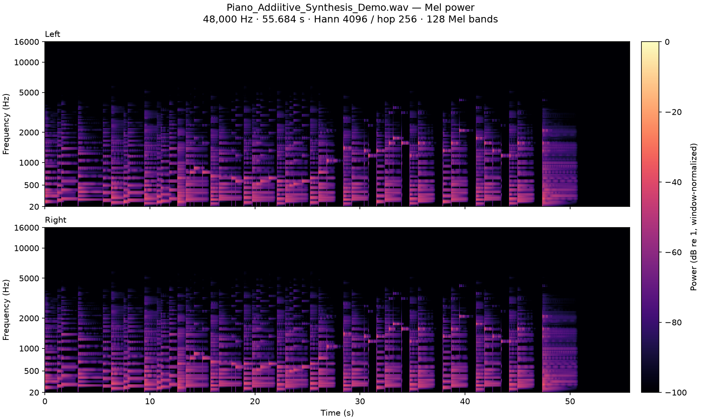
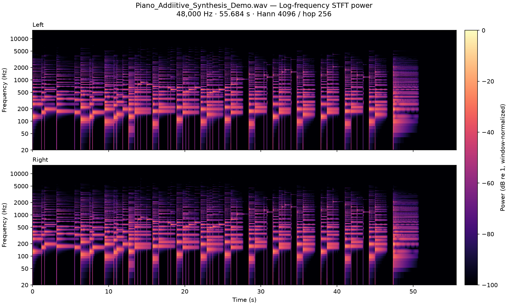
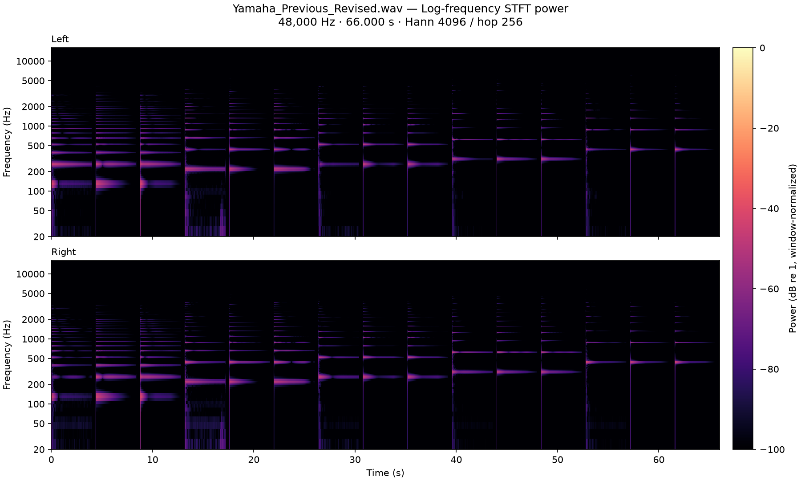

# Current results and validation

[Documentation home](../README.md) · [Method](reference-and-method.md) · [History](development-history.md) · [Evidence index](evidence-index.md)

These results compare the **bass-enriched additive instrument** with the subsequent **C3–B4 refinement**. They do not compare against the early physical-only piano. The current refinement keeps the existing harmonic orders and changes levels/decay, rather than adding another bank of higher harmonics.

## Spectral comparison

The reference-energy-weighted absolute partial-level error is averaged over five stages from 100 ms to four seconds. Lower is closer under this metric. Reference normalization is fixed to the preceding instrument's early-body power for both versions.

| Dataset | Cases | Before | After |
| --- | ---: | ---: | ---: |
| Fitting grid: eight pitches × velocities 40/60/92/124 | 32 | 3.240 dB | 0.813 dB |
| Recorded layers at velocities 76/108, excluded from fitting | 16 | 3.104 dB | 0.833 dB |
| Semitone-transposed pitch proxies at velocity 92 | 8 | 3.229 dB | 1.968 dB |

The fitting-grid averages by pitch are:

| Note | Before | After |
| --- | ---: | ---: |
| C3 | 2.615 dB | 1.054 dB |
| D#3 | 2.948 dB | 0.824 dB |
| F#3 | 4.920 dB | 0.570 dB |
| A3 | 8.188 dB | 0.316 dB |
| C4 | 2.120 dB | 0.751 dB |
| D#4 | 2.480 dB | 1.744 dB |
| F#4 | 1.373 dB | 0.682 dB |
| A4 | 1.276 dB | 0.562 dB |

The large A3 change reflects correction of an overly weak/rapidly declining fundamental and related partial balance. C3 needed a different trajectory: reducing excessive fundamental energy during part of the decay while restoring the second partial's later contribution. One uniform “more sustain” adjustment would not have addressed both.

Black is Yamaha, orange the preceding instrument and blue the revised instrument. All curves retain the same early reference; they are not normalized frame by frame. These plots expose remaining dips from physical/additive interference, especially in selected second/fourth partials. A lower aggregate error does not imply every curve matches at every instant.

The proxy pitches are D3, F3, G#3, B3, D4, F4, G#4 and B4. D3 worsens from 2.833 to 3.278 dB; B3 from 1.787 to 2.497 dB. The other six improve under this proxy test. Because the targets were transposed from nearby keys, these results are an approximate interpolation check, not measured fidelity to recordings of those exact pitches.

Raw records: [summary](data/middle/summary.json), [fitting-grid before](data/middle/before.json) / [after](data/middle/after.json), [holdout before](data/middle/holdout_before.json) / [after](data/middle/holdout_after.json). Each stage record includes total-level change as well as spectral error.

## Complexity and storage

| Current measurement | Value |
| --- | ---: |
| `prepiano` / `oscil3` / `expsega` | 1 / 2 / 5 |
| `adsyn` definitions and files | 51 |
| Editor nodes, including structural markers | 156 |
| Native instrument ZIP | 169,703 bytes |
| Graph document inside the ZIP | 392,855 bytes |
| HETRO payloads | 378,041 bytes |
| Total uncompressed instrument payload | 770,896 bytes |
| Native demo ZIP | 210,156 bytes |

The current model is larger than the initial 34-file additive conversion because it stores more detailed middle profiles and retains the original C3 branch for bass interpolation. It remains much smaller as a delivered instrument than the earlier megabyte-scale explicit-oscillator graph. Compression, node count and execution cost are separate measurements; no fresh current-version CPU benchmark is claimed.

Three redundant middle velocity files were removed. This changed the fitting-grid error only from 0.8118 to 0.8129 dB. The full graph and all 51 generated payloads were reproduced deterministically; native bundles were inspected to ensure they contain those same payloads.

## Preservation and audio checks

The [current validation record](data/middle/validation.json) records 69 audio renders/checks. These include:

- All integer notes A0–B2 and C5–C8 at velocity 92, before and after, with bit-identical output.
- Additional protected notes at simultaneous minimum and maximum control settings, also bit-identical.
- The same ten control IDs, labels, ranges and defaults; each control's minimum and maximum changes the middle audition when applied to fresh notes.
- Increasing measured RMS across velocities 40/60/92/124 at nine middle pitches.
- Eight-note chords, an extreme-settings chord, short notes, repeated notes and a 20-second hold at maximum String decay.
- Finite audio, tested peaks below clipping, matching stereo channels and completed release tails.

These are specified test cases, not exhaustive proof for all chords, tunings, velocities or parameter combinations. Bit identity refers to the protected renders relative to the immediately preceding instrument, not to the Yamaha recordings.

The update preserved the same saved instrument/demo identities. In the demo configuration, only the piano definition was refreshed; routing, mixer settings, controller overrides, pitches, velocities and timing are unchanged. The exported MIDI file is byte-identical, and SCORE note events match. There are **110 notes / 220 note-on and note-off events**.

| Demo render | Duration | Rate/channels | Peak amplitude | Final tail peak |
| --- | ---: | --- | ---: | ---: |
| SCORE | 55.684208 s | 48 kHz / stereo | 0.640072 | 0 |
| MIDI file | 55.684208 s | 48 kHz / stereo | 0.642662 | 0 |

The two render modes need not produce identical waveforms. Both passed their export/audio checks. The native bundles package the same authored graph and required analysis assets.

These overview plots use a 4096-sample Hann window and 256-sample hop. They show the note groups, harmonic trajectories and silent tail; they are not first-25-ms measurements. The demo preserves the established two-hand arrangement and velocity variation.

The comparison plot contains groups C3, A3, C4, D#4 and A4 at velocity 92. Each group is Yamaha → previous → revised, using four-second excerpts and 0.4-second gaps; groups begin at 0, 13.2, 26.4, 39.6 and 52.8 seconds. Only Yamaha is gain-matched to the fixed previous-model early-body power; both model versions use the same gain. The plot is an analysis artifact, not a claim that the synthetic stereo sound matches the recording.

## Verification boundaries

Compile preflight, native bundle expansion, asset inclusion and deterministic regeneration passed. The frontend production build and Docker frontend build passed during the instrument update; the existing frontend chunk-size warning remained. Final Mel/log-STFT images and harmonic-decay plots were opened and inspected. No listening by ear was performed in these validation runs.

The strongest evidence is improved measured partial trajectories on the fitting grid and recorded velocity holdouts, plus preservation of the requested external registers. Remaining differences include fine unison beating, weak-partial shapes, phase interactions, the acoustic body/microphone/room field and control settings outside the fitted conditions. The instrument is a compact synthetic interpretation of the Yamaha reference, not an exact physical or sampled replica.
