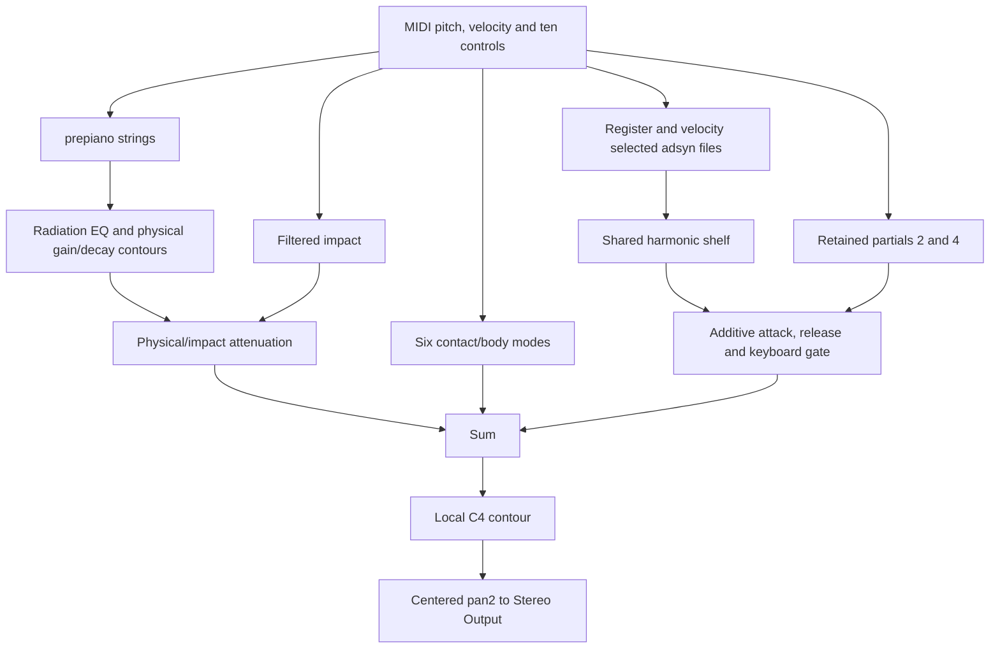

# Architecture and mixing

[Documentation home](../README.md) · [Registers and controls](registers-and-controls.md)

## Four cooperating sound components

| Component | Implementation | Role in this instrument |
| --- | --- | --- |
| Physical strings | `piano_strings` / `prepiano`, followed by radiation EQ and gain contours | Responsive string excitation, fundamental and physical modes; detuning, stiffness, strike and hammer interaction |
| Additive reinforcement | Register-selected `adsyn` banks, summed into `hetro_tone` | Correct the frequencies, levels and temporal evolution of tonal partials against the Yamaha reference |
| Retained partials | `piano_partial_2` and `piano_partial_4` / `oscil3` | Keep two dominant components with the existing tuning and phase behaviour; middle-range envelope levels are refined |
| Attack/contact response | Filtered impact branch plus six weighted contact modes | Brief attack/body contribution, especially in the upper range; distinct from the sustained harmonic bank |

Csound's [`prepiano`](https://csound.com/docs/manual/prepiano.html) models struck strings and supports optional preparations. Here the preparations are disabled: using the opcode does not imply a rattling or rubber-prepared piano. Its string/hammer parameters remain part of the playable design.

[`adsyn`](https://csound.com/docs/manual/adsyn.html) sums sinusoidal tracks whose amplitudes and frequencies follow breakpoint data. This instrument generates those files numerically. It does not load the Yamaha recordings into a sampler, and it does not run the `hetro` analysis utility during performance.



## The actual summing relationship

There is **no fixed 50/50 blend** and no single physical/additive crossfade knob. The final `output_pan2.asig` formula can be written without changing its algebra as:

```text
physical = signal × amplitude × core × contour
contact  = gain × (3.644 body1 + 2.475 body2 + 3.094 body3
                  + 7.535 body4 + 5.180 body5 + 7.274 body6)
additive = partial_gate × (bank + partial2 + partial4)

output = ((physical + impact) × (1 − mix) + contact + additive)
         × shape_c4
```

The [authored formula and its node bindings](../analysis/data/middle/design_snapshot.json) are preserved alongside the measurements. `signal` is the radiation-filtered physical output; `bank` is the summed HETRO output after its shared shelf. `mix` belongs to the physical/impact/contact treatment—it is **not the percentage of `adsyn` in the output**. The contact modes have their own pitch-, velocity- and time-dependent gain.

Amplitude and Output dB factors occur inside the component paths. Their effects should not be inferred from the final sum alone. Release gating and the additive attack window also occur upstream. `shape_c4` is a local gain contour inherited from the compact model, not a peak limiter. Centered `pan2` provides the two output channels; the tested channels are identical. This does not recreate the Yamaha recording's stereo field.

## Why fit the combined signal?

The layers overlap in frequency. Two oscillatory components near the same frequency may reinforce or cancel; their powers cannot generally be added as if they were unrelated noise. This is why blindly adding the Yamaha's measured harmonic amplitudes on top of the physical model would overcorrect some notes.

The latest refinement rendered the full instrument and isolated physical/core, second-partial, fourth-partial and HETRO stems. For a candidate stem gain `g`, its local spectral power was predicted using:

```text
P(g) = P(1) + 2(g − 1) Re(full × conjugate(stem))
             + (g − 1)² |stem|²
```

The cross term accounts for phase-dependent interference. Bounded gain updates moved existing envelopes toward the target, followed by a fresh full render and measurement. This is an approximation over a measurement window, not exact phase reconstruction of the Yamaha.

In parts of C3–B4, the physical second partial exceeded the target even when its added oscillator was reduced. The existing radiation EQ was therefore repurposed within that range to attenuate around twice the fundamental, then the additive envelope was refitted. No extra EQ node was added. Outside that range the previous EQ remains active unchanged.

## Why retain both synthesis methods?

`prepiano` alone provides a physical response, but earlier measurements showed too few strong harmonics and the wrong distribution of decay energy. Its parameters cannot independently set every partial's trajectory. `adsyn` makes those trajectories economical to author and store, but its fixed tracks do not simulate the full string/hammer system or automatically respond to physical controls.

An all-additive piano is possible, but it would be a different design: the attack, control responses and physical unison behaviour would need to be recreated. For this instrument, the hybrid preserves useful physical behaviour while correcting the spectrum. Neither layer is required to dominate every note or moment; the additive gate fades out between C5 and C6, leaving the uppermost keyboard to the physical/contact model.

The second and fourth partials remain explicit because their replacement during the initial `adsyn` conversion changed interference with the strings and weakened the approved attack. `adsyn`'s fixed-point oscillator and zero-phase start do not reproduce those oscillator paths exactly. Keeping two oscillators was a deliberate quality/complexity compromise.
