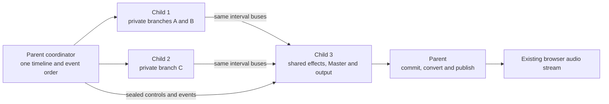

# Persistent Csound process implementation plan

Status: T01–T05 delivered; updated 2026-11-07. T06–T08 remain pending. This document defines the implementation sequence; the [implementation record](implementation-record.md) identifies executed work and limits. Read the [scope and decisions](README.md), [contracts](contracts.md) and [acceptance plan](acceptance.md) together. Session parallel rendering is not enabled.

## 1. Outcome and invariants

Render eligible performances using coarse instrument branches in persistent child processes. Improve rendering headroom where independent DSP is expensive enough to outweigh synchronization, while retaining the existing renderer for all other cases.

The following are release requirements:

1. The browser remains the playback clock and receives one ordered stereo PCM stream. Browser queue targets and render-request limits do not change.
2. Every process uses the full performance's resolved engine settings. Never choose settings independently from the first instrument in each subset.
3. Every stage, instrument voice, insert, shared effect and Master processor executes exactly once per applicable block. Direct output still bypasses Master.
4. Inter-process dependencies transfer samples for the same engine interval. No implicit sample/block delay, duplicated wet path, lost sidechain, or independent resampling is allowed.
5. Musical scheduling and application state have one authority. Existing polymeter, rational timing, note ownership, auditions, live edits, independent devices and controller revisions retain their contracts.
6. Unknown cross-instrument state prevents an unsafe split. Invalid performances remain invalid; fallback cannot bypass validation.
7. A live instance never changes process owner. A renderer change requires a stopped session and fresh start semantics.
8. Current single-renderer behavior remains independently testable. The default stays single until the release gates pass.

Full core utilization is not an acceptance criterion. A serial critical path, small workload or restrictive CPU quota can legitimately select one renderer.

## 2. Existing integration points

| Responsibility | Current source and integration constraint |
| --- | --- |
| Session lifecycle and browser render requests | [session_service.py](../../backend/app/services/session_service.py); preserve lifecycle locking and controller lease checks |
| Session renderer ownership | [session_runtime.py](../../backend/app/engine/session_runtime.py); owns one `RealtimeRenderer`, currently constructed as the original single worker through the shared factory |
| Native rendering, controls, MIDI and render boundaries | [csound_worker.py](../../backend/app/engine/csound_worker.py); retain this implementation as the single renderer |
| MIDI ordering and source ownership | [midi_scheduler.py](../../backend/app/engine/midi_scheduler.py), [lane_output.py](../../backend/app/engine/lane_output.py) |
| Performance controller values and revisions | [performance_controllers.py](../../backend/app/engine/performance_controllers.py); delivery must happen once, not once per child |
| Sequencer and arpeggiator connection | [session_performance_runtime.py](../../backend/app/services/session_performance_runtime.py) |
| Timing and PCM responses | [browser_clock_runtime.py](../../backend/app/services/browser_clock_runtime.py), [browser_audio_pcm.py](../../backend/app/engine/browser_audio_pcm.py), [ws.py](../../backend/app/api/ws.py) |
| Mixer graph resolution and Csound emission | [compiler_mixer.py](../../backend/app/services/compiler_mixer.py); reuse routing and control semantics |
| Patch compilation and global setup | [compiler_service.py](../../backend/app/services/compiler_service.py), [compiler_orchestra.py](../../backend/app/services/compiler_orchestra.py), [compiler_legato.py](../../backend/app/services/compiler_legato.py) |
| Audio and API contracts | [audio.py](../../backend/app/models/audio.py), [session.py](../../backend/app/models/session.py), [frontend types](../../frontend/src/types/index.ts) |
| Process-isolated live preparation | [sequencer_preparation.py](../../backend/app/services/sequencer_preparation.py); keep configuration preparation separate from rendering |
| Deployment and admission | [config.py](../../backend/app/core/config.py), [Dockerfile](../../Dockerfile), [Compose](../../docker-compose.yaml) |

Consult [BACKEND.md](../../BACKEND.md), [clock ownership](../../CLOCK_OWNERS.md), [routing](../../documentation/performance/audio_mixer_and_routing.md) and [browser clock](../../documentation/configuration/browser_clock_latency.md) before changing these contracts. The task table and implementation record distinguish delivered modules from proposed ones.

## 3. Runtime architecture

Introduce an internal `RealtimeRenderer` interface matching the worker operations actually used by services: start/stop, status and engine settings, render cursor, render requests, timestamped MIDI, lane releases, panic, controls, meter draining, controller state and render-boundary actions. Preserve the meaning of `EngineRenderResult` and existing mock-engine behavior.

Keep `CsoundWorker` as the single implementation. T02 uses structural conformance to the interface and a shared factory, preserving direct calls into its proven render loop without a forwarding wrapper. Add `ParallelCsoundRenderer` as a facade with one coordinator and fixed child ownership. Extract only the small native-instance operations needed by children; do not instantiate full independent session workers with their own sequencers and authoritative MIDI schedulers.

| Proposed module | Responsibility |
| --- | --- |
| `backend/app/engine/realtime_renderer.py` | Interface and shared start/render results; future selection capability/status types belong to their implementing gates |
| `backend/app/engine/renderer_factory.py` | Shared construction, always selecting the original single renderer in T02 |
| `backend/app/models/render_plan.py` | Frozen graph, resource, cost, ownership and diagnostic plan records (T03) |
| `backend/app/services/compiler_render_graph.py` | Read-only LIVE/MIDI stage, port, helper and control snapshot (T03) |
| `backend/app/services/compiler_render_resources.py` | Conservative structured compiler resource audit (T03) |
| `backend/app/services/render_partition_plan.py` | Pure dependency classification, eligibility and deterministic partition selection |
| `backend/app/services/compiler_stage_lowering.py` | Shared structured setup, MIDI assignments, stage bodies and ordered connections (T04) |
| `backend/app/services/compiler_partitioned.py` | Internal realtime partition programs and boundary adapters; canonical exports unchanged (T04) |
| `backend/tools/_sequential_partition_probe.py` | Sequential native DSP/block-parity harness; never used by sessions (T04) |
| `backend/app/engine/parallel_csound_renderer.py` | Timeline, dispatch, lifecycle, completion and output coordination |
| `backend/app/engine/csound_process.py` | Spawned child entry point and exclusively owned native instance |
| `backend/app/engine/render_ipc.py` | Versioned control protocol, shared-memory buffers and ownership |
| `backend/app/services/render_capacity.py` | Container-aware CPU/memory budgets and process reservations across sessions |

Child processes live from successful start until stop/delete/failure. Restart creates a new epoch and fresh native instances. Do not create a process for each render request, use a general task pool for stateful synthesis, fork an initialized Csound instance, or increase web-server worker count to parallelize a session. Use an explicit spawn context and a fixed, import-safe child entry point.

Each child runs one Csound instance with native parallel rendering disabled for this first mode. Process/thread multiplication would invalidate the capacity budget. Csound's built-in parallel mode may be measured separately as a comparison, not enabled implicitly inside children.

## 4. Dependency and partition contracts

### 4.1 Immutable plan

Produce an internal versioned `RenderPartitionPlan` containing:

- Full-performance engine settings and a hash of graph, patches, compiler capability version and relevant assets.
- Stable stage IDs and exactly one owner partition per stage.
- Partitions, predecessor/successor lists and deterministic topological order.
- Boundary buses with source/destination stage and port, channel order, native sample type, block length, and producer/consumer ownership.
- Local instrument references, note/helper ownership, control-channel routing, meter ownership and MIDI subscriptions.
- Resource declarations, unsupported reasons, estimated work, critical path, cut-buffer bytes and capacity requirements.
- Selected renderer, selection reason and provenance of cost estimates; distinguish estimates from observations.

Store this alongside the session compile artifact as internal data. Preserve the canonical single-orchestra artifact for existing compile responses and fallback. Do not expose child CSDs, IPC handles, shared-memory names or internal process IDs in ordinary public responses. Runtime partition ownership is not saved performance data and requires no native bundle or performance format bump.

T03 deliberately stops before session integration: the immutable diagnostic plan is returned only
to an explicit internal caller. Its `layout` may be coarse, but `selected_renderer` is always single
and `execution_eligible` is false. No qualified runtime cost profile is supplied by default.
Native lowering and admission must be implemented and tested before attaching executable plans
to session lifecycle or consuming them at start.

### 4.2 Build the stage graph

Resolve the entire performance once using the existing mixer normalization, port validation and generated direct-output routes. Preserve patch, raw/bypass, strip, route and final output stages. Include both pre/post inputs used by live route selection and dry/wet bypass dependencies, even when the current coefficient is zero.

The compiler currently has a separate path when no explicit audio graph is provided. Initially classify this path as `legacy_compile_path` and retain the single renderer. Extending eligibility requires explicit legacy/direct/always-on parity tests; do not silently route old sessions through new mixer lowering.

Validate genuine feedback with the existing diagnostics before planning. Strongly connected components may explain invalid audio cycles; they do not authorize those cycles. Do not delete muted, solo-excluded, bypassed, currently empty or apparently silent stages merely to obtain a wider graph. State and tails still matter.

### 4.3 Declare non-audio resources

Add structured compiler metadata describing resource access and scope. Avoid regex-based inference from emitted Csound as the primary safety mechanism.

| Resource | Initial rule |
| --- | --- |
| Per-voice oscillators, envelopes, delays and private tables | Keep with the owning instrument |
| Legato collectors, panic listeners and other generated helpers | Keep with their state owners; split a shared helper only after equivalent per-owner generation is tested |
| Instrument scheduling, allocation limits and cross-instrument queries | Remap local references and preserve scope; cross-owner semantics require explicit analysis or fallback |
| Explicit numbered tables, table mutation or dynamic table references | Establish read/write ownership; ambiguous cross-instance use falls back for the whole session |
| Shared mutable channels or plugin/global state | Add ordering and co-location constraints; unknown behavior falls back |
| Host mixer/performance controls | Explicit subscriptions and timestamped writes; these alone do not force co-location |
| MIDI reads including controller channels other than note assignment | Record subscriptions; conservatively fan out the ordered MIDI stream if pruning is unproven |
| SoundFonts and other assets | Local handles, bounded repeated loading and asset identity checks; handle values never cross IPC |
| Read-only resources | Replicate only after initialization/lifetime independence is established |
| Random generators | Classify sequence/state coupling; unclassified behavior stays single in automatic mode |

Keep stable instance scopes and control names across both renderers. Do not automatically rename numbered tables: that could remove intentionally shared behavior. Do not silently choose new random seeds. Sample equality is required for deterministic fixtures; stochastic compatibility requires an explicit per-family contract before automatic eligibility.

Maintain an allowlist of audited compiler/opcode behaviors with a capability version. Any opcode metadata or support changes during implementation must follow the repository's opcode-support workflow. Plugins and future opcodes default to unknown, rather than inheriting eligibility accidentally.

### 4.4 First partition algorithm

Use a conservative branch-plus-shared-suffix strategy for the first release:

1. Form mandatory co-location groups for inseparable state and helper stages. Check the resulting graph for cycles; absorb intervening stages where safe, otherwise select single. Never ignore a cycle introduced by grouping nonadjacent nodes.
2. Identify independent upstream processing domains in the validated stage graph. Propagate domain provenance in topological order. A stage whose inputs originate in multiple domains is a join. Stages without audio input still need state/control classification.
3. Put joins and all their descendants into one downstream partition. Include Master, its inserts, final output and their required stage paths there. Expand this partition to satisfy co-location constraints. Check that no downstream stage feeds an upstream partition.
4. Keep each remaining private branch together, including local routes, strip processing and private inserts. Attach disconnected stateful work conservatively; do not prune it. If dependencies prevent a valid branch split, return a reasoned single plan.
5. Assign whole independent branches to a bounded number of upstream processes using descending estimated cost, with stable identity tie-breaking. One process may own several small independent branches. The downstream process counts against the same worker budget.
6. Recheck complete stage coverage, single ownership, all cut ports and an acyclic partition graph. Require at least two upstream work groups with meaningful concurrent cost; one upstream process plus an entirely dependent suffix offers no block-parallel benefit in this release.
7. Compare predicted cost against the single baseline. Reject an expensive cut or dominant shared suffix; unknown costs keep automatic mode single until a qualified profile exists.

The shared suffix can contain multiple effects that are logically independent. Executing it serially is an intentional first-release limitation. General DAG scheduling of several downstream processes is a later extension only if profiling shows it matters.

Use DSP time, active polyphony and tail cost estimates rather than node count alone. Estimates are advisory; topology and ownership stay fixed while running. Any cost cache must include the relevant runtime/platform, engine settings and graph identities. Do not render a hidden benchmark or start audible voices during normal session start to learn costs.

## 5. Compiler and bus lowering

Refactor graph resolution and stage emission into a shared internal representation consumed by both compiler paths. Keep the canonical single path's numerical behavior and ordering unchanged. Do not split generated CSD text with string slicing.

For each partition, emit its stage bodies once, local `connect` statements, required global setup and local helper references. Generate explicit ingress stages before their consumers and egress collectors after all contributing voices/stages. A crossing polyphonic outlet exports the summed bus, not the most recently rendered voice. Keep node/global namespaces stable and remap all MIDI/score/helper instrument references consistently.

Export route outputs after their existing gain/pan/tap operations where practical. This keeps mutable mixer behavior in the original Csound stages. Keep bypass and its dry/wet processing with the effect where possible. A cut must never change a raw tap into a strip tap or collapse distinct sidechain/main buses.

Use host audio channels or native input/output buffers for boundary adapters, selected by a native correctness/performance probe. Preallocate buffer views; do not share Csound-owned pointers across processes. Verify precision using the actual binding's native sample type, not an assumed float width. Copy at boundaries where required; shared memory is not automatically zero-copy Csound I/O.

Preserve the baseline contribution order at each sum. Keep separate ordered contributions if pre-summing in another worker would change grouping. If exact arithmetic ordering is impossible for a candidate cut, qualify an explicit numerical tolerance against deterministic fixtures before enabling it; never conceal a phase or timing error inside an amplitude tolerance.

The downstream process owns final `$output` summation and output meters. Convert to float32 and apply the existing resampling behavior once in the parent after completed final output. Intermediate buses bypass the existing stereo-only PCM conversion helper.

Compile the partition plan and all local artifacts before successful start. Local compilation errors cannot leave a partially audible session. Canonical compile response, instrument audition and offline MIDI/SCORE CSD exports retain their current path. Partition programs are internal realtime playback inputs only; offline export parallelization is outside this project.

## 6. Realtime timing and control protocol

### 6.1 Sample and epoch ownership

Let `K` be the unchanged global `ksmps`. A block covers `[S, S + K)`. The coordinator owns:

- `epoch`: fresh on every start or invalidating stop/failure.
- `committed_sample`: end of the complete audio rendered by all required partitions; backs the existing `render_sample_cursor` meaning.
- `sealed_sample`: end of the interval whose input/control decision is fixed.
- `published_sample`: end of audio handed into the ordered browser-response path; this is not the browser's audible cursor.
- Per-partition completed positions, internal only.

For the first release, at most one global block is sealed but not committed: `sealed_sample - committed_sample <= K`. Never advance the public render cursor because only an upstream worker finished. Enforce monotonic sample positions within an epoch and exact predecessor sample ranges.

### 6.2 Block execution

For each block in the existing browser request:

1. Acquire session render ownership. Apply queued render-boundary actions in existing order and verify the session/epoch remains valid.
2. Call the existing sequencer and arpeggiator advancement exactly once for this block.
3. Drain due MIDI once through the authoritative scheduler and lane gates. Deliver performance-controller CC updates once, then snapshot coalesced control-channel writes. Preserve ordering for equal timestamps and existing block-level delivery quantization.
4. Seal an immutable block descriptor carrying epoch, sequence, sample start, control revision, ordered MIDI/control data and bus-slot identities.
5. Dispatch eligible upstream workers concurrently. Each applies the descriptor's events/controls and calls `performKsmps()` once. It publishes its bus data before marking completion.
6. When all inputs for the shared suffix are ready, render the same interval in the downstream worker. It must never read last block's data as a substitute.
7. Check completion/error state, collect meters with engine timestamps, commit `S + K`, and append final samples to the response buffer. Begin the next block only afterward.
8. At request completion, retain existing transport markers, float32 encoding, resampling and response ordering. Recheck lease/epoch before publication.

Capture event acceptance races with an injectable clock and explicit synchronization barriers. An event arriving after the block's MIDI drain must enter the next eligible block, matching the baseline decision point. Preserve existing late-event reporting semantics; do not claim within-block sample accuracy where the current MIDI callback delivers a block's events together.

The browser's multiple pending requests remain queueing behavior, not permission to render overlapping session intervals. Keep one render owner per session.

### 6.3 Live operations

Execute callbacks passed to `run_at_render_boundary` in the parent; closures and service objects never cross IPC. Complete a boundary action under render ownership even when no PCM is requested, as the current worker does. Pure parent-state actions can finish immediately there; native control application retains its defined next-block delivery semantics.

Preparation remains outside rendering. A successfully prepared sequencer edit changes the authoritative configuration at one boundary and affects all workers through the next descriptor. A failed preparation keeps the previous playing configuration and edited draft. There is no independent preparation or transport advancement per child.

Mixer gain/pan/mute/solo, bypass ramps, lane releases, perf-controller values and mapping revisions must all derive from the complete performance graph, even when delivered only to owning workers. Keep the existing continuous-instrument I-rate restart rule. Sidechain gates and pre/post tap changes cannot be computed from a worker-local graph.

Prioritize stop and lifecycle cancellation ahead of unstarted work. Stop invalidates the epoch, cancels pending preparation/application as currently specified, prevents stale PCM publication and releases every worker. Preserve the distinction between arranger/device Stop and engine Stop. Panic must cover all appropriate local note/helper references rather than assuming the same instrument number in every orchestra.

### 6.4 Batching decision

Strict synchronization is the shipping correctness contract. Optimize native copies, preallocated descriptors, wakeups and Csound calls first. A native IPC loop may be necessary, especially at `ksmps=1`; Python per-block futures/queue serialization are not an assumed viable performance solution.

Control-plane messages may be batched only if workers still cannot consume an unsealed block. Rendering several future blocks from a single frozen event snapshot changes live-input and edit acceptance. Such speculative batching is outside this delivery. If strict timing cannot yield a measured improvement at a particular engine rate, select single for that rate rather than changing `ksmps`, increasing browser queues or silently adding scheduling lookahead.

## 7. IPC, capacity and lifecycle

### 7.1 Bounded IPC

Use preallocated shared-memory audio slots plus a compact, versioned control protocol. Proposed lifecycle messages are `INIT`, `READY`, `RENDER`, `DONE`, `ERROR`, `STOP` and `STOPPED`. Every render descriptor and completion carries protocol version, session epoch, plan hash, block sequence, sample range and slot generation. Children reject mismatches.

Start with two slots per exported bus for clear ownership; strict mode still has only one block in flight. Reserve producer/consumer state and release slots only after all listed consumers finish. Protect publication with synchronization primitives having defined process memory ordering. Ordinary Python shared counters are not sufficient publication fences. Reject duplicates, stale completions and unexpected shapes without advancing the cursor.

Use bounded event/control storage sized from existing quotas and measured worst-case bursts. Never truncate a note-off or block the API indefinitely when IPC fills. Known capacity shortages before dispatch select fallback at startup; runtime overflow is a diagnosed fatal renderer error unless the existing scheduler already defines an equivalent rejection behavior. Aggregate admission must include descriptors, shared buses, samples/SoundFonts and child native state.

Memory estimation includes `slots * K * native_sample_bytes * exported_channels`, plus controls/metadata and local asset/DSP allocations. Validate counts before allocation. Close and unlink owned shared-memory segments exactly once, including partial startup, child crash, parent shutdown and cancellation. Handle resource-tracker behavior explicitly on supported Python/platform builds.

### 7.2 Capacity policy

Calculate effective CPU capacity from process affinity and the effective cgroup hierarchy, including v1/v2 quota and cpuset restrictions. Honor Docker Desktop VM limits through the CPUs actually available inside the container. An unavailable quota file is not evidence of unlimited resources; log detection provenance and use a conservative platform fallback.

Introduce process-wide leases so multiple sessions and the existing preparation process cannot each assume ownership of all CPUs. The downstream renderer counts as a worker. Account for API, coordination and preparation headroom. Begin experiments with a configurable maximum of eight rendering children, capped by useful work and effective capacity; finalize defaults in the measurement gate. Fractional quotas require measurement and conservative rounding, not one process per visible host core.

Automatic eligibility for the first topology needs two concurrent upstream workers plus the suffix worker. Smaller budgets use single mode. Capacity can be shared by the OS between phases; process count is a conservative admission ceiling, not a claim that all workers are busy simultaneously.

Do not pin CPUs or enable realtime scheduling privileges by default. Do not resize or steal a running session's workers. Changed capacity affects the next start; runtime pressure produces telemetry and can suppress future parallel selection.

### 7.3 Selection and fallback

Proposed deployment setting: `VISUALCSOUND_REALTIME_RENDERER=single|auto|parallel`, initially defaulting to `single`. Keep separate deployment caps for workers, shared-memory bytes, startup/stop timeouts and render watchdogs. Freeze validated ranges/defaults in Task 01 and Task 07; these are runtime settings, not musical document fields.

| Situation | `single` | `auto` | `parallel` diagnostic mode |
| --- | --- | --- | --- |
| Qualified graph and budget | Existing renderer | Qualified parallel plan if predicted beneficial | Parallel |
| Unknown state, no useful split, unsupported compile path/build | Existing renderer | Single with reason | Actionable pre-start error |
| Insufficient process or memory budget | Existing renderer | Single with reason | Actionable pre-start error |
| Child startup/compile failure before playback | Existing renderer | Clean up children, then attempt canonical single start once | Clean up and fail |
| Invalid graph or invalid asset | Existing validation failure | Same validation failure | Same validation failure |
| Active child crash, hang, stale/corrupt result | Existing failure handling | Coordinated stop/error; quarantine parallel for this session's next explicit start | Coordinated stop/error |

Automatic pre-start recovery is allowed only after rollback to a clean initial state. No PCM, MIDI consumption or sequencer advancement may have escaped. If start was cancelled or the epoch changed, do not attempt the fallback start. Preserve the primary failure reason and any secondary fallback error.

Never splice a newly started single engine into an active stream. Arbitrary oscillator, random, delay, reverb and note state cannot be recovered from the last output buffer. On fatal runtime failure discard the incomplete request, retain the last complete cursor for diagnosis, invalidate future output, stop all children and use existing session error/frontend stop behavior. Specify and test the frontend's treatment of already queued audio; do not promise to retract audio already played. The next user-requested start follows normal fresh-start semantics and can select single.

Use bounded, cancellable waits. A render watchdog is based on the supported request/queue budget and measured service tails, not the assumption that every process completes within one audio block's wall duration. Startup and compilation have separate deadlines. After graceful stop timeout, terminate and reap children, then release capacity and memory. Never retry a partially advanced native block.

## 8. API and compatibility

Preserve the existing PCM binary format, render metadata meanings, controller lease, request limits, event quotas and session lifecycle statuses. Add optional renderer diagnostics to the existing runtime status/event contract only: requested/selected mode, partition/worker count, fallback reason, qualification status and aggregated timing counters. Keep `backend=ctcsound` meaningful; add a renderer field rather than silently redefining backend values.

Update frontend types and status handling together with backend schemas. Initially expose diagnostics in existing runtime/status surfaces, not a new musical configuration workflow. Old clients must continue functioning when optional fields are absent. Ensure mock mode reports itself and cannot qualify native parallel performance.

Keep offline exports and public single CSD compilation canonical. Do not put execution-plan data into saved configurations, native bundles, arranger history or autosave. Test that switching renderer selection across stopped starts does not alter authored data.

## 9. Ordered implementation tasks

Each task ends with reviewable evidence. Do not start production cutover before the preceding gates pass.

| Task | Depends on | Work and completion gate |
| --- | --- | --- |
| T01 Baseline and contracts | None | Capture native single-renderer traces and timings; inventory worker callers, stateful opcode behavior, timing races and build capabilities. Freeze protocol schemas, settings bounds and acceptance fixture definitions. G1: repeatable baseline and explicit eligibility matrix. |
| T02 Renderer boundary | T01 | Add the interface/adapter and session wiring while selecting only existing single/mock implementations. G2: existing API/runtime tests and trace parity; no repeatable baseline performance regression. |
| T03 Pure partition planner | T01, T02 | Add resource metadata, graph grouping, suffix algorithm, capacity estimates and reasoned diagnostics without starting children. G3: coverage/acyclicity/ownership tests and deterministic plan snapshots for all fixtures. |
| T04 Partition compiler | T03 | Introduce shared stage representation and boundary emitters. First execute local native instances sequentially in a test harness to isolate compiler correctness from IPC. G4: audio, event, meter and controller parity; canonical compiler/exports unchanged. |
| T05 Persistent processes and IPC | T02, T04 | Spawn lifecycle, shared buffers, strict sample descriptors, native per-worker loop and parent coordinator. G5: real process rendering passes deterministic timing/audio tests; bounded startup/stop and exhaustive ownership cleanup. |
| T06 Live integration and recovery | T05 | Wire boundary actions, edits, auditions, controllers, lane gates, host MIDI, lifecycle races, status and fallback. G6: integrated API and production-browser scenarios, including worker failure and next-start fallback. |
| T07 Capacity and performance qualification | T06 | Implement cgroup-aware leases and measured selection policy; optimize strict synchronization. Compare single/parallel with identical rates and browser settings. G7: published raw measurements and passing workload/platform thresholds. |
| T08 Documentation and gated release | T07 | Document deployed contracts, controls, limits and failure behavior; preserve single override. G8: full checks, native Docker qualification, user-facing documentation/help and operational rollback verified. |

Use proposed focused test modules `test_render_partition_plan.py`, `test_partitioned_compiler.py`, `test_render_ipc.py`, `test_parallel_csound_renderer.py` and `test_render_capacity.py`. Add backend behavior regressions to `backend/tests/test_api.py` and relevant existing services as required by repository rules. Version all new workloads under `backend/tests/fixtures/`; do not import developer examples.

T04 is a deliberate stop/go point: if the compiler cannot preserve a resource family's semantics, narrow eligibility and document fallback rather than proceeding with an approximate split. T07 is also a stop/go point: correct but slower execution remains an opt-in diagnostic mode, not automatic production behavior.

## 10. Release and rollback

Roll out in stages: single-only interface, planner diagnostics, explicit parallel mode in tests/development, narrowly qualified automatic mode, then any proposal to change the default. Default cutover is a separately reviewable change backed by G1–G8, not an incidental consequence of adding the feature.

Maintain a runtime/build qualification matrix and invalidate affected entries after Csound, Python binding, IPC or compiler capability changes. Pin or record the actual image digest and native versions used for evidence; a mutable image tag is insufficient. A deployment override to `single` affects new starts; drain or explicitly stop existing parallel sessions before applying a full rollback. No data migration or performance re-save is needed.

Update README capabilities while preserving its protected opening and Built With Codex section. Update BACKEND.md, CLOCK_OWNERS.md, routing, engine/browser-clock settings and live-status documentation only when implementation exists. Keep the manual English-only. Localize exposed UI/help in EN/DE/FR/ES; if layout/interaction changes, capture fresh screenshots and reference them. Rebuild and inspect the manual PDF when its source changes.

Record actual implementation choices, commands, failures, measurements and remaining restrictions in a future `implementation-record.md`. Do not mark any gate complete using a mock engine, graph analysis alone, historical results or measurements from a different runtime build.
