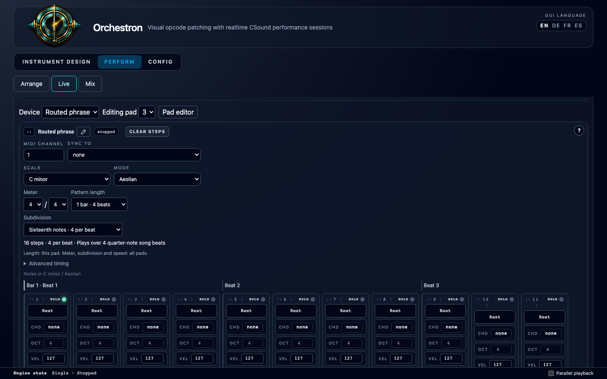

# Milestone 2 · Perform view state and edit isolation

Arrange, Live and Mix now run inside the real Perform preview. A musician can leave a chorus variation partly edited, change a pad on the same instrument, adjust the mix and return to the original variation. The normal application entry point still opens the established Perform page. Milestone 3 introduces the bounded shell, right Inspector and split editor. [Implementation plan](implementation-plan.md)

## Open the preview

1. Start the temporary backend and Vite profiling server using the [two local commands](../../frontend/tests/performance/README.md#clip-arranger-acceptance). The temporary database keeps the fixtures separate from your library.
2. Open `/tests/performance/workspace.html` on the Vite server and choose **Perform**. The preview uses the application's normal project commands, editors and audio engine.
3. Extract the [milestone 1 fixtures](baseline/performance-fixtures.zip). Use **Import** to open `clip.orch.json` or `legacy.orch.json`. Both bundles use the same two instruments. When importing the second bundle, the existing baseline instruments can be reused.

## What the views remember

| View | What returns when you come back |
| --- | --- |
| Arrange | Selected clip and expanded lane, occurrence path and repetition, edit scope, timeline zoom and scroll, and structural focus. The legacy arranger retains its existing lane, range and clipboard state. |
| Live | Selected device, its editing pad, pad editor visibility, keyboard and MIDI panel disclosures, and scroll. Choosing an editing pad targets its authored contents. |
| Mix | Selected rack instance or Master, routing disclosures and controls, mixer bank scroll and the view's scroll position. Two instances of the same patch have distinct identities. |

The active view and its presentation belong to the current performance workspace. Instrument Design can be visited and left again. Successful New, Load and performance Import start a fresh workspace, including a second load of the same ID. Cancel, failed load and first save preserve the current workspace. Reloading the browser starts a new view session.

The stored musical draft and its scope stay with the original occurrence. Leaving Arrange detaches its write target before the Live editor can accept input. Returning resolves the lane, clip, repetition, nested path and definition against the current arrangement. A removed target stays closed. Switching views or pressing the current view button again does not itself start playback, select a playing pad or apply a draft. An outgoing editor ends an audition it owns. Project Save, Export and replacement commands share one draft dialog across views. [View controller](../../frontend/src/components/sequencer/PerformWorkspace.tsx) · [Editor state](../../frontend/src/components/sequencer/PerformanceEditorState.tsx) · [Edit routing](../../frontend/src/store/sequencerEdits.ts)

## Browser checks

The following checks used Chromium in English at 1440 × 900 with the milestone 1 fixtures, an isolated SQLite library and the native backend.

| Exercise | Observed result |
| --- | --- |
| In **UX Baseline Clip**, open **Routed phrase → Chorus**, choose **Create variation here** and toggle the first step's **HOLD**. In Live, select **Routed phrase**, editing pad **3**, open **Pad editor** and toggle its first **HOLD**. | Only physical pad 3 changed. The clip draft, its scope, the authored clip arrangement and the seven other pads survived the Live edit. |
| Select **Master** in Mix. Choose **Save Performance**, then **Cancel**. Visit Instrument Design and return to Perform. Reopen Live, then Arrange and **Save variation here**. | Cancel kept Mix active. Re-entering Perform returned to Mix. Live restored pad 3 and its open editor at 385 px of scroll. Arrange restored the same draft at 165 px. Saving created the chorus variation and preserved the Verse definition. |
| Start Instruments in Mix. Play the clip arrangement and switch **Live → Mix → Mix → Arrange**. | The same session advanced from tick 2,520 to 7,560. The edit revision stayed fixed. The browser sent zero sequencer commands to the audio worker and zero sequencer writes over HTTP during navigation. Tick values vary between runs. |
| Choose **New** from Mix. Load **UX Baseline Legacy** and double-click a Routed phrase pad occurrence in the timeline. Select pad 3, visit Mix and Arrange, then return to Live. | New reopened Arrange and cleared the Live target. The legacy shortcut opened the matching device's pad editor. Live restored pad 3 and its device, and the song stayed in legacy format. |

With **UX Baseline Clip** loaded and the engine stopped, run `playwright-cli run-code --filename frontend/tests/performance/verify-workspace-navigation.js` from the repository root in the browser session that has the preview open. The check observes transport and configuration traffic during the switches and stops the test session afterward. [Playback check](../../frontend/tests/performance/verify-workspace-navigation.js)

The frontend check passed lint, all 1,473 tests and the production build. The focused tests exercise a dirty second repetition, a surviving sibling definition, a removed repetition, failed and canceled replacements, and both scroll axes when a mounted pane changes owner. Geometry of the final shell and the independent pad-launch workflow are covered by later milestones. [View-state regressions](../../frontend/src/components/sequencer/PerformWorkspace.test.tsx) · [Workspace generation tests](../../frontend/src/store/performanceWorkspaceGeneration.test.ts)
