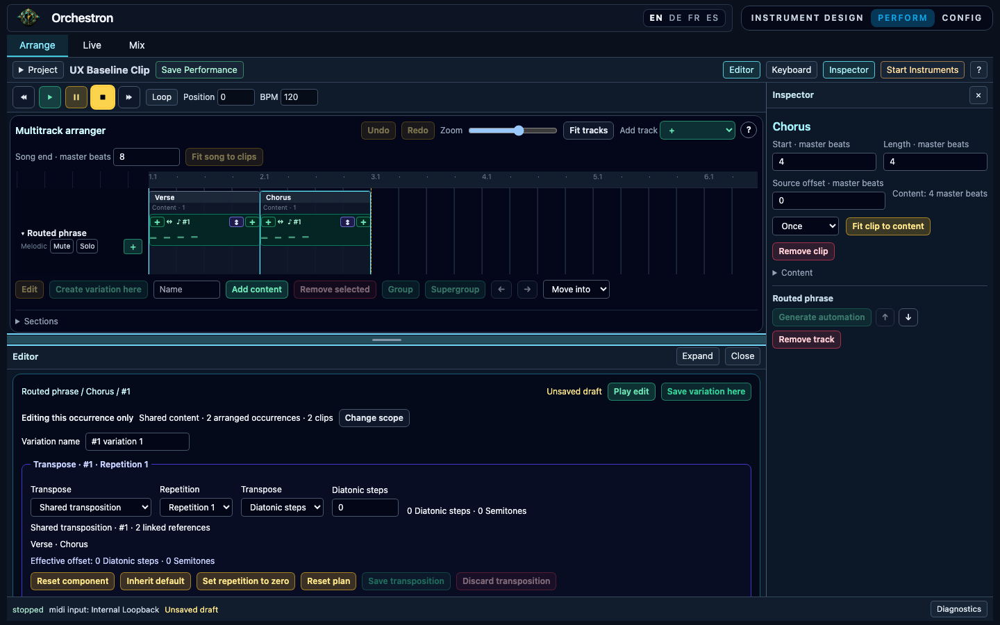
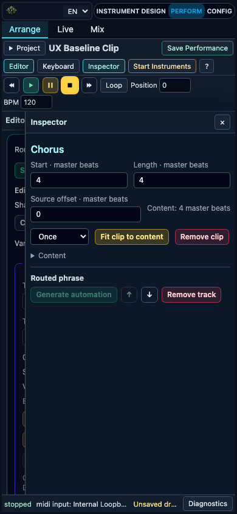

# Milestone 3 · Bounded Perform workspace

The preview keeps the song transport above the working pane and the session status at the bottom of the browser. Arrange opens a clip editor or keyboard below the timeline. The right-hand Inspector spans both panes. Live and Mix use the same project controls, transport and status. The normal application still opens the established Perform page.



## Try the preview

1. Start the [isolated backend and frontend server](../../frontend/tests/performance/README.md#clip-arranger-acceptance). Open `/tests/performance/workspace.html` on that server and choose **Perform**.
2. Extract the [baseline performances](baseline/performance-fixtures.zip). Choose **Project → Import** and load `clip.orch.json`. Select **Chorus** on **Routed phrase** to inspect it. Double-click the clip or choose **Editor** to open its draft.
3. Drag the full-width divider. With it focused, Up and Down move 10 px, Shift moves 1 px, and Home and End reach the limits. Escape restores the pre-drag height. **Expand** gives the editor the working area. **Restore split** returns to the timeline and editor.
4. Choose **Keyboard** to replace the editor, then **Editor** to return to the clip. **Close** releases the whole dock. **Fit tracks** adjusts row height without changing the song. Use **Fit song to clips** when you intend to change its authored end.
5. Switch to Live or Mix while playing. Song commands remain in place. **Start Instruments** and **Stop Instruments** control the engine. **Save Performance** and the project menu work from all three views. Status shows the engine state, MIDI input, pending draft changes and errors. **Diagnostics** provides the full error, engine statistics and access to audio configuration.

## Small windows

The preview uses a single pane below 700 px of working width or 600 px of window height. It can switch sooner when wrapped controls leave too little room. The split reserves at least 180 px for the dock and caps its height at 60% of the column. The clip overview also reserves room for its ruler, a track and its editing controls. The stored height returns when the window grows.

On a phone, **Back to overview** returns from the editor. **Inspector** opens a right-edge drawer below the transport. Close or Escape returns focus to its button. Each view remembers its drawer and desktop Inspector separately.



## Verification

| Exercise | Observed result |
| --- | --- |
| Desktop, 1440 × 900 | With the dock closed, Arrange occupied all 697 px of the working column below the transport. Opening the 260 px editor or restoring a 244 px split kept track names at x = 22 and the ruler at y = 247 CSS px, rounded. Closing the Inspector returned its width to the main column. |
| Editor resize and recovery | Pointer capture continued outside the grip. Escape, pointer cancellation, lost capture, window blur and resizing the window during a drag restored the previous preference. Keyboard resizing respected both limits. The mounted editor node, draft, authored song and edit revision stayed intact through the drag. |
| Browser zoom and translations | At actual 200% Chromium zoom, a 1280 × 723 viewport became 640 × 361 CSS px. The document fitted both axes. Hit tests reached the visible controls, and Project, Inspector, overview return and Diagnostics worked. Phone checks also passed in English, German, French and Spanish. |
| Timeline scroll | With ten melodic tracks and the timeline zoomed in, the timeline scrolled 345 px vertically and 1,123 px horizontally. Track names kept their left edge, the transport stayed fixed, and the document stayed 900 px tall. |
| Running transport | The same native session advanced through Live, Mix and Arrange and a divider adjustment. The browser sent zero sequencer commands to the audio worker and zero sequencer writes over HTTP during those operations. |
| Edit isolation and errors | Editing physical pad 3 in Live preserved the open Arrange draft on that device. Canceling **Save Performance** in Mix preserved the current view. Starting the engine with an empty rack produced a visible error that survived navigation and appeared in Diagnostics. |
| Compatibility | A legacy occurrence opened its matching Live pad editor. A new clip performance offered **Add track** on the empty timeline. The ordinary application URL opened the original Perform page. |

To replay the split and transport checks, open the preview in an English Playwright Chromium session at 1440 × 900. Load a fresh **UX Baseline Clip** with the engine stopped. From the repository root, run the following in that browser session.

```sh
playwright-cli run-code --filename frontend/tests/performance/verify-workspace-shell.js
playwright-cli run-code --filename frontend/tests/performance/verify-workspace-navigation.js
```

The preview uses the existing clip, device, keyboard and mixer actions. Later milestones cover the full Arrange, Live-launcher and mixer workflows. [Implementation plan](implementation-plan.md) · [View-state contracts](milestone-2-view-state.md)
