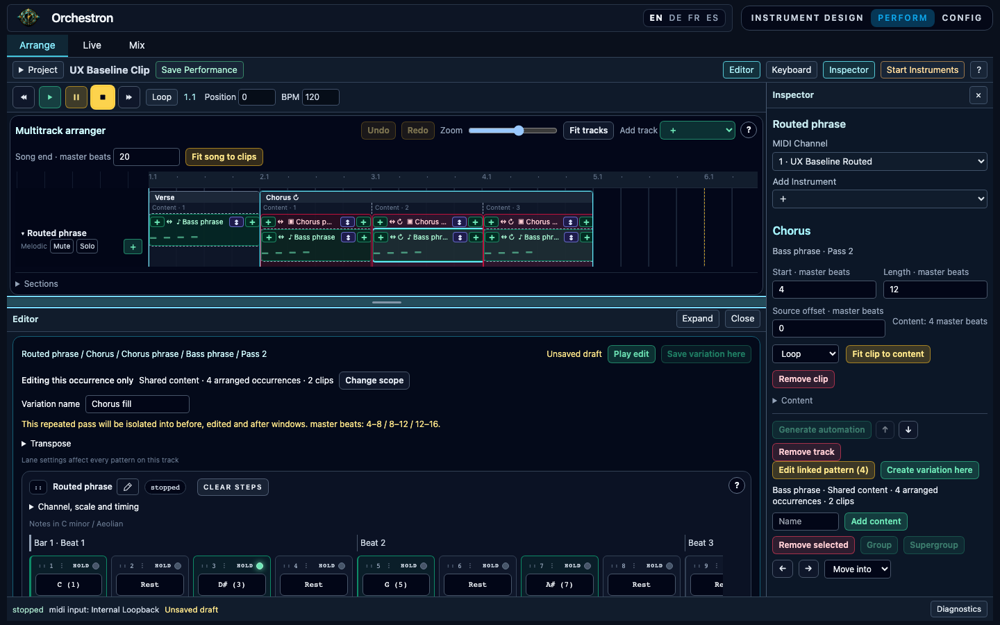
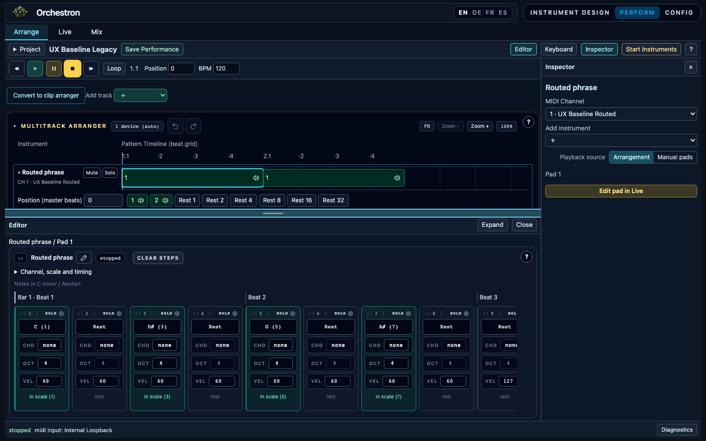

# Milestone 4 · Arrange in the Perform preview

The optional workspace preview opens clip-based songs and legacy pad arrangements. Both share the song transport, timeline, right-hand Inspector and resizable editor. The regular application URL opens the established Perform page.

## Try a chorus variation

1. Start the [isolated preview servers](../../frontend/tests/performance/README.md#clip-arranger-acceptance). Open `/tests/performance/workspace.html`, choose **Perform**, then **Project → Import**. Extract and import `clip.orch.json` from the [baseline bundle](baseline/performance-fixtures.zip).
2. Click **Chorus** on **Routed phrase**. The Inspector shows the track's MIDI destination and the clip's start, length, offset and Once/Loop mode. Selecting a clip leaves a closed editor closed. Expand the lane to choose a particular group, pattern or repetition.
3. Double-click the pattern, or select it and choose **Editor**. When the editor is already open, clicking another compatible pattern follows the selection. The breadcrumb identifies the edited occurrence. **Loop** in the transport uses the selected clip's time range.
4. Choose **Create variation here**, name the fill and edit a step. **Play edit** auditions the draft. **Save variation here** applies it to the selected occurrence. Choosing the linked scope instead shows the usage count on Save. A pattern used once offers **Save pattern here**.
5. Leave the draft open, switch to **Live** and edit a physical pad on the same device. On returning to Arrange, check the breadcrumb, selected step, scope and scroll position. **Save Performance** is a separate project action.



Groups and supergroups open in the structural editor. Its Save action uses the selected scope. A conflicting musical draft can be saved or discarded explicitly. **Cancel** returns to editing with that draft intact. For instrument-bound automation, edit a point directly inside its timeline occurrence and use the scoped Save in the dock.

## Start from an empty timeline

Choose **Add track** and pick melodic, drummer, Score, controller or arpeggiator. A new clip-based track opens its first pattern in the matching device editor. Select an assigned instrument's MIDI channel in the Inspector or use **Add Instrument** to add a saved playable patch. With an empty library, **Create playable instrument** saves the built-in voice, adds it to the rack and routes it to Master. Enter a note, choose **Start Instruments**, then **Play edit** to audition it.

## Edit a legacy performance

Import `legacy.orch.json`. Click a pad occurrence to inspect the track and its playback source. Double-click the pad or select it and choose **Editor**. The dock names the device and physical pad. Edits affect every use of that pad in the legacy sequence. **Edit pad in Live** opens the same device and pad in the launcher. After choosing a different pad there, returning to Arrange restores the pad you were arranging.



**Convert to clip arranger** is an explicit action in clip-enabled builds. A manual-source incompatibility identifies the track and leaves the legacy arrangement available. Successful conversion downloads the original configuration as a backup. The compatibility build keeps the legacy workflow and can still edit an existing clip-based performance.

## Replay the browser checks

Use the English workspace preview in Chromium at 1440 × 900, with a temporary database and native audio enabled. Import both baseline bundles and save them under their supplied names, **UX Baseline Clip** and **UX Baseline Legacy**. Load the indicated saved performance with the engine stopped before each run. Run the scripts from the repository root in the same Playwright CLI session that has the preview open.

| Starting performance | Browser check | What the check verifies |
| --- | --- | --- |
| UX Baseline Clip | [Clip editing](../../frontend/tests/performance/verify-workspace-arrange.js) | Builds a repeated nested chorus through the config reader. Loops it during native playback, changes physical pad 3 in Live, restores the dirty second pass, selected step, scope, zoom and both scroll positions. The local save leaves three sibling uses untouched. A linked group rename reaches all three uses, Cancel at a 390 px phone width preserves a conflicting draft, and an inline automation point survives Save. |
| UX Baseline Clip | [First track](../../frontend/tests/performance/verify-workspace-first-track.js) | Opens all five device editors. Assigns a library instrument, creates a starter from an empty library, auditions and saves the first note. Opens the ordinary application in a fresh tab and verifies its Perform entry. |
| UX Baseline Legacy | [Legacy editing](../../frontend/tests/performance/verify-workspace-legacy-arrange.js) | Edits physical pad 1, retains Live pad 3 independently and compares the authored legacy sequence. With conversion enabled, checks rejection and the backup download after correcting the source. With conversion disabled, checks legacy editing and opening a stored clip song. |

```sh
playwright-cli run-code --filename frontend/tests/performance/verify-workspace-arrange.js
playwright-cli run-code --filename frontend/tests/performance/verify-workspace-first-track.js
playwright-cli run-code --filename frontend/tests/performance/verify-workspace-legacy-arrange.js
```

Run the legacy script once with the default Vite configuration, then again with `VITE_CLIP_ARRANGER=0` set when starting Vite. The first-track check creates a patch in the temporary library. The remaining design work is tracked in the [implementation plan](implementation-plan.md).

The shell regression check measured the same ruler and track-header positions with the editor closed, open and resized. During the navigation check, the native playhead advanced and there were zero additional sequencer commands or configuration writes. One earlier native playback run reported a disconnected browser-clock socket. The subsequent playback and navigation checks completed without that error.
