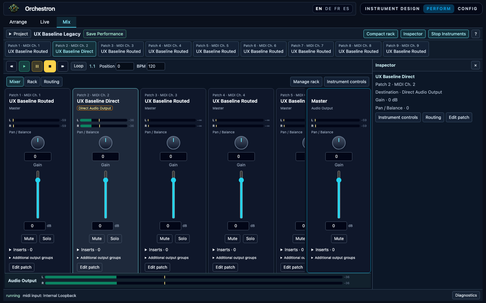
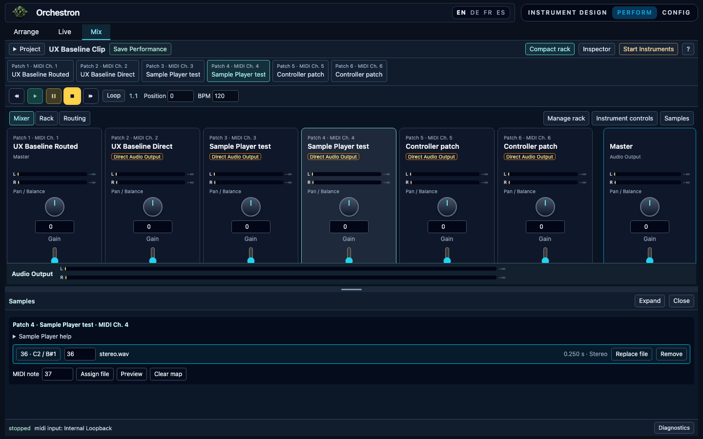

# Milestone 6 · Mix in the Perform preview

Open `/tests/performance/workspace.html`, choose **Perform**, then **Mix**. The ordinary Perform page remains the default. Clip and legacy performances share the same Mixer, Rack and Routing views and the same runtime controls.

## Follow a signal

- **Mixer** scrolls the instrument and return strips together. Master has its own column and scroll position. The stereo Audio Output meter stays below both and includes direct paths. Each visible meter reads the current engine snapshot. Leaving Mixer or scrolling a meter out of sight releases its subscription.
- Select a strip name or a **Compact rack** entry to change the Inspector target. A closed dock stays closed. **Instrument controls** or **Samples** opens the selected instance below the overview. Selecting a compatible instance follows it, including when two slots use the same patch.
- **Manage rack** opens the full Rack. Assign patches and channels or reorder the rack here. **Routing** opens the source editor, channel matrix, diagram, feedback diagnostics and repair actions. Inspect routing during playback and use the explicit stop action to change topology. Existing sends, strip controls and eligible insert Bypass remain live.
- In Arrange and Live, the compact rack starts closed. Its selection is local to the view. Its named commands open Mix with the chosen instance targeted. The ordinary view buttons restore each view’s previous selection and panels. Instrument Design uses the existing patch editor and audition.

## Native browser checks

The legacy run started **Manual lead** on pad 2 and **Routed phrase** on its arrangement. Both devices ran while the check observed the engine’s left peak and sampled PCM at the browser’s audio destination. The two phrases have different attacks, so the first two rows sample different moments of the same playback.

| Observation | Master peak | Final output peak | Browser PCM peak |
| --- | ---: | ---: | ---: |
| Routed phrase sounding | 0.00612 | 0.00612 | 0.02250 |
| Direct phrase sounding | 0.00040 | 0.05600 | 0.04025 |
| Master muted, direct strip sounding | 0 | 0.06175 | 0.03937 |
| Master and direct strip muted | 0 | 0 | 0 |

The browser output stayed silent for a further two seconds with both paths muted. The PCM probe and the engine meter observe different time windows. Values vary with the musical position.

At 1280 × 720, the nine-strip bank restored its bottom-right position after a trip to Arrange, 1,037 pixels horizontally and 218 vertically. Scrolling the bank left the bounds of Master and Audio Output fixed. The offscreen strip released its meter. At 390 × 844 both pinned regions fit. Opening Routing, including its matrix, retained the running session and the topology lock. **Stop to edit rack** stopped the engine explicitly.

The clip run assigned `mono.wav` to MIDI 36 on one Sample Player and `stereo.wav` to MIDI 36 on a second instance of the same patch. Both previews used the correct assignment and note. Switching instances sent Stop for the first gesture. Closing Samples sent Stop for the second while the performance engine kept running. Two copies of a controller patch also retained separate values and MIDI mappings. The first kept Amount 0.625 and CC 17 through a visit to Instrument Design. The second kept its 0.2 default and unassigned CC.

## Replay

Start the [isolated backend and Vite preview](../../frontend/tests/performance/README.md#clip-arranger-acceptance) with native Csound. Load the [baseline performances](milestone-1-baseline.md) in its disposable library. Use a fresh preview page with English selected, the engine stopped and a 1440 × 900 Chromium viewport for each check. Run from the repository root with `playwright-cli run-code --filename` and the indicated script.

| Starting performance | Script |
| --- | --- |
| UX Baseline Legacy | [Signal path, two-axis scroll, topology locks and phone geometry](../../frontend/tests/performance/verify-workspace-mix.js) |
| UX Baseline Clip | [Compact rack navigation, sample assignments, preview ownership, controls and CC mappings](../../frontend/tests/performance/verify-workspace-mix-instances.js) |
| UX Baseline Clip | [View switches and divider changes during playback](../../frontend/tests/performance/verify-workspace-navigation.js) |

The two Mix scripts capture the screenshots above. The instance check adds test patches to the disposable library. The existing [native mixer audio tests](../../backend/tests/test_mixer_audio.py) cover signal paths, inserts and sends independently of browser geometry.

Verification passed with 1,479 frontend tests, lint, the production build and 65 native mixer audio tests. The running clip navigation check recorded zero sequencer writes and zero worker transport commands. The Arrange draft and Live device regressions also passed, including the check that the ordinary Perform entry opens the established page. The updated English manual passed `make docs-check` and its Mix and Samples screenshots were checked in the generated PDF.
