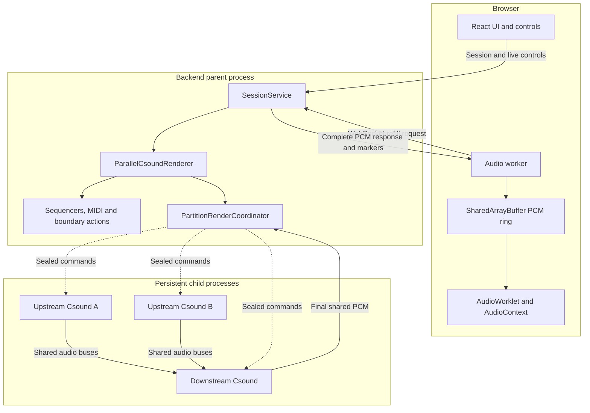
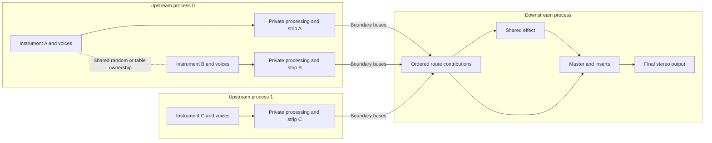
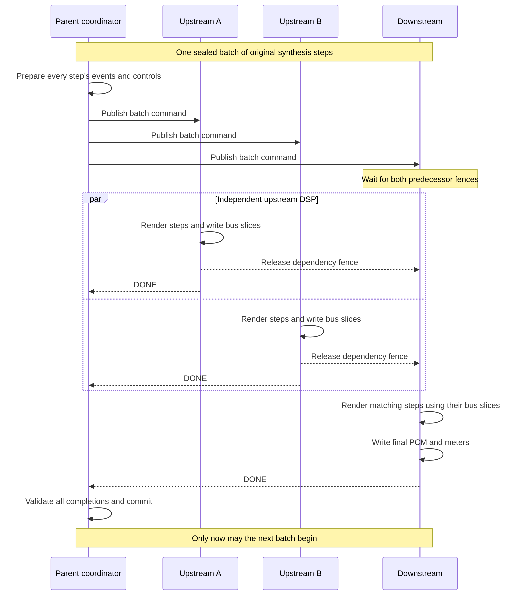
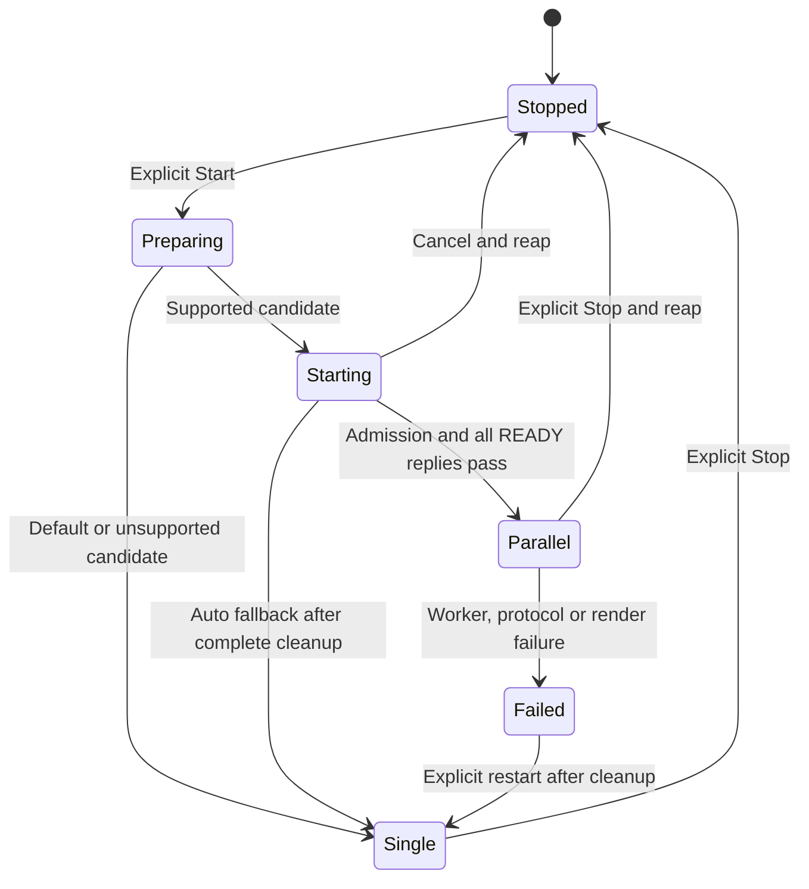

# Parallel Csound Rendering

**Navigation:** [Up](technical_documentation.md) | [Prev](technical_documentation.md)

Orchestron can distribute realtime synthesis across persistent Csound processes. Independent instrument groups render concurrently; a shared downstream process renders joins, shared effects, Master and final output. The parent retains musical scheduling and delivers one complete PCM response to the existing browser-clock pipeline.

This chapter describes the implementation as of 2026-11-08, including whole-instrument graph selection and configurable coordination batches. The [whole-instrument contract](../specifications/parallel-csound-rendering/whole-instrument-partitioning.md) supersedes the earlier per-song qualification catalog. The [batching contract](../specifications/parallel-csound-rendering/coordination-batches.md) supersedes coordination after every individual synthesis step. Earlier T01–T08 records remain useful implementation history; their original selection and scheduling restrictions are not all current behavior.

## Scope and architectural choices

Single rendering remains the default. A public session request can explicitly select `renderer_mode="auto"`, allowing parallel rendering when the current graph and available resources support it. Auto retains single rendering as the compatibility fallback. Parallel rendering applies to realtime playback; public compilation and offline CSD exports remain canonical and single.

| Choice | Reason and consequence |
| --- | --- |
| Partition whole instruments and their private processing | All voices, envelopes, filters and private state of an instrument retain one native owner. Individual voices and opcode nodes are not distributed between workers. |
| Derive independence from the resolved compiler graph and resource semantics | Rack order and audio cables alone cannot reveal shared tables, random streams or initialization dependencies. |
| Use one persistent Csound instance per child process | Each child exclusively owns its native state and advances it serially through `performKsmps()`. Processes can be stopped and reaped independently of a hung native call. |
| Keep one parent scheduler | Sequencers, arpeggiators, MIDI ordering, lane gates and controller revisions retain one authority. Children execute prepared deliveries and DSP. |
| Exchange audio through bounded shared memory | Large audio arrays do not travel through serialized command messages. Explicit publication fences establish when a consumer may read them. |
| Keep one coordination batch in flight globally | All dependencies complete before the next batch starts. Cross-process routes use audio from the same synthesis step, without inserting a delay block. |
| Preserve the single renderer and canonical compiler | Unsupported graphs and failed startup can use the validated original CSD. Active failures stop playback; native state is not reconstructed mid-stream. |

The implementation does not split polyphony, duplicate shared effects, repartition running instruments, transport arbitrary native handles or change native performance bundle formats.

## Runtime boundaries and ownership

The browser remains the playback clock. Its dedicated audio worker requests PCM and writes a `SharedArrayBuffer` ring; the AudioWorklet consumes that ring under the AudioContext clock. The backend advances Csound only when asked to render. Parallel execution changes how the backend produces a chunk, while retaining this clock and buffering model.



`ParallelCsoundRenderer` extends `CsoundWorker` to reuse the existing parent scheduler, pending-control storage, lane gate and render-boundary queue. It delegates native rendering to `PartitionRenderCoordinator` when parallel is active, and to the original worker on fallback. Ordinary single sessions construct `CsoundWorker` directly through the [renderer factory](../backend/app/engine/renderer_factory.py).

Each child runs `NativeCsoundPartition`: one Csound instance, a local MIDI callback buffer and native audio-channel bindings. No session services, Python scheduling callbacks or borrowed Csound pointers cross the process boundary. A separate child watchdog watches the parent process so parent death can terminate a child even while native compilation or rendering is stuck.

Browser implementation: [audio worker](../frontend/src/audio/browserClockWorker.ts), [AudioWorklet](../frontend/src/audio/browserClockProcessor.js) and [clock ownership reference](../CLOCK_OWNERS.md).

## Partitioning the performance graph

### Reuse the compiler's stage graph

`CompilerService.analyze_realtime_graph()` produces an immutable `RenderDependencyGraph` from the same `ResolvedMixerGraph` used for canonical compilation. Stages include patches, bypasses, strips, routes and output. Metadata preserves canonical stage order and ordered connection contributions, alongside engine settings, control and meter channels, helper instruments and resource access declarations.

The planner therefore partitions executable compiler stages, rather than interpreting the visual patch graph independently. All stages and connections remain accounted for, including silent or disconnected work. Every connection is either local to a partition or represented by one boundary bus.

### Preserve native state ownership

The [resource analyzer](../backend/app/services/compiler_render_resources.py) combines known opcode semantics with parameter-expression inspection. A shipped [semantic identity snapshot](../backend/app/data/render_resource_semantics.json) detects custom or changed definitions whose native state assumptions are no longer established.

| Resource or relationship | Ownership rule |
| --- | --- |
| Voices, instrument strip, bypass and private inserts | Stay with their instrument owner. |
| Shared mutable numbered tables | Group declarations, readers and writers in one process. Dynamic table references and automatic `ftgenonce` allocation join the table domain. |
| Built-in sine tables | Table 1 can be replicated read-only under the canonical wrapper; native sine table -1 is private/read-only. A writer to table 1 requires shared ownership. |
| Shared native random stream | Group its consumers, including `rnd`/`birnd` in scalar expressions, to preserve relative random consumption. |
| MIDI initialization and compiler helpers | Co-locate related `initc7`/reader stages and scoped helper users where their initialization or state requires it. |
| Unknown global state, unsupported native assets or unbounded allocations | Retain single rendering with a diagnostic reason. Unknown resource memory is not treated as zero. |

Ordinary arithmetic, filters, envelopes and internal If/Switch branches stay inside whole instruments. They need no separate parallel opcode implementation. Conversely, an otherwise ordinary opcode can contain an expression that introduces shared or unknown state.

### Build a coarse upstream/downstream layout

The pure [`plan_render_partitions()`](../backend/app/services/render_partition_plan.py) algorithm:

1. Validates the immutable graph and merges stages constrained by shared resources, private processing and helpers.
2. Merges intervening dependency paths when needed to keep the grouped graph acyclic.
3. Identifies independent upstream origins. Joins, explicitly downstream stages and their successors form one shared suffix; disconnected work is conservatively placed there too.
4. Packs complete upstream branches into workers. Without measured costs, stage work and voice-resource declarations supply structural weights. It chooses the fewest workers attaining the smallest estimated upstream critical path.
5. Records owners, local connections, ordered boundary buses and a deterministic plan hash. Fewer than two useful upstream groups, unsupported resources or exceeded bounds produce a single layout.



This is an illustrative ownership layout, not a requirement to route every instrument through Master. Direct-output semantics are preserved by the original stage graph. The final output stage still has one owner.

Structural weights are balancing heuristics, not microsecond estimates or evidence of speedup. When explicit benchmark cost profiles are supplied, the planner can also check predicted savings including downstream, dispatch and copy work. A successful proposal still has `selected_renderer="single"` and `execution_eligible=false`: pure planning performs no OS probes, starts no processes and cannot authorize execution.

## Compiling partition programs

[`compile_realtime_partitions()`](../backend/app/services/compiler_partitioned.py) first performs canonical patch-bundle compilation and asset validation. It checks that the supplied plan matches the current full-performance graph. Canonical and partition compilation share structured stage lowering, preserving DSP statements, local contribution order and full-performance engine settings (`sr`, `ksmps`, channels and `0dbfs`).

For each partition, the compiler emits only its owned stages, setup, controls, MIDI assignments and helpers. Cross-process connections become generated ingress/egress instruments backed by named Csound audio channels:

- An egress collector reads the instrument's summed polyphonic outlets and writes each outgoing contribution to a native audio channel. It reads all inlets before writing, because Csound inlet/outlet buffers can alias.
- An ingress instrument reads the incoming native channels and feeds the original local connections in compiler order.
- Separate cut contributions remain separate buses; they are not prematurely summed into an unordered mix.

The result contains a canonical artifact plus private partition CSDs, local instrument/note reference manifests, bus bindings, ownership declarations and hashes. Local references are needed because a subset program cannot assume canonical numeric instrument references remain valid. Compilation validates complete ownership and artifact integrity but still does not select a runtime.

## Shared memory and process coordination

### Provision once per runtime epoch

The coordinator uses Python multiprocessing with the `spawn` start method. At startup, it allocates one `SharedArena` containing immutable bootstrap records, bounded command/reply mailboxes, audio buses, final output buffers and meter storage. Bootstrap records carry the CSD and layout metadata; child arguments contain only the shared-memory reference, bootstrap digest and synchronization handles.

Audio buses preserve native `MYFLT` width. Startup verifies the native ABI, engine format and audio-channel API before accepting `READY`. Each bus has two slots, selected by batch sequence, and enough frames for every synthesis step in the configured batch. Meter storage likewise retains a row per step. Double buffering does not allow two batches to run concurrently: the global barrier still limits execution to one.

The parent owns creation and unlinking. Layout accounting includes bootstrap data, mailboxes, meters, final buffers and page alignment, not just cut-bus audio. Linux allocation reserves shared-memory pages before writing, so an exhausted `/dev/shm` can fail startup rather than cause a later page fault during rendering.

### Publish samples with explicit fences

Semaphore release/acquire operations publish commands, dependency audio and acknowledgements. A shared counter alone is not a memory fence. The parent sends commands to every worker before collecting replies. Dependent children wait directly on all predecessor fences, avoiding a parent wakeup and redispatch between upstream and downstream work.



The protocol binds messages to an epoch, partition and plan. Render records additionally identify sequence, engine-sample interval, control revision and bus-slot generations. The coordinator checks exact acknowledgements, detects dead workers and rejects duplicate, stale, unsolicited or mismatched completions. Bootstrap and artifact hashes connect each child to the provisioned program and layout.

Empty deliveries use compact `RBL2`/`DBL2` records bound to the bootstrap digest. Eventful batches use validated `RENDER_BATCH` records containing individual `RENDER` steps; a single eventful step uses `RENDER`. Lifecycle and error messages remain typed JSON. Dense batches that exceed mailbox capacity split before dispatch without draining the scheduler again or dropping events. One oversized synthesis step remains a diagnosed failure.

### Keep native conversion and buffer lifetimes local

Audio channel copy functions and meter readers bind once at startup. Transfers still copy through Csound's native get/set audio-channel APIs; shared memory does not make Csound's internal buffers shared between processes. Borrowed pointers remain inside the native owner and cannot survive its reset.

The output child converts samples to float32 on its native thread, preserving Csound's floating-point/subnormal behavior. The parent assembles engine-rate PCM and resamples once per complete request. Nonfinite audio/meters and float32 overflow are failures. A failed request returns no partial PCM, even if earlier batches in that request completed.

## Synthesis timing and coordination batches

Three different intervals must remain distinct:

| Interval | Responsibility |
| --- | --- |
| Synthesis step: `ksmps` engine frames | One `performKsmps()` call and one original scheduling/control boundary. |
| Coordination batch: one or more synthesis steps | One command and completion barrier per worker. Reduces process handoffs. |
| Browser render request and playback queue | Requests multiple synthesis steps and buffers their PCM for AudioWorklet playback. |

The configured batch size is rounded down to complete synthesis steps, with a minimum of one:

```text
batch_blocks = max(1, configured_frames // ksmps)
effective_frames = batch_blocks * ksmps
```

At 48 kHz and `ksmps=32`, the default 256-frame batch contains eight unchanged synthesis steps and spans 5.333 ms of engine time. A value of 255 becomes 224 frames; values below `ksmps` still produce one full step. Short requests and final remainders use smaller batches.

Before sealing a batch, the parent runs boundary actions and sequencers, drains timestamped MIDI, applies performance-controller delivery and coalesces pending controls once per original synthesis step. Children apply each prepared step's MIDI and controls immediately before that step's `performKsmps()`. They read and write the corresponding bus slice and sample meters at the same step. Already scheduled events therefore retain their original synthesis-step timing.

MIDI is an ordered broadcast to all partitions. Instrument note-channel assignments do not describe every MIDI reader: a patch may subscribe to another channel's controller. Pruning by assigned note channel would silently change behavior. Named controls go to their declared subscribers, with monotonically advancing parent revisions. Metadata must cover all legitimate parent mixer writes, including fields ignored by a particular DSP route.

The coordinator distinguishes three cursors:

- **Scheduling cursor:** exposes the exact step during preparation, then the next unsealed boundary for newly arriving events.
- **Committed cursor:** advances as successfully validated batch output is accepted.
- **Published cursor:** advances only after a complete PCM request is ready to return.

Input arriving after preparation cannot modify a sealed interval and targets the next available boundary. Larger batches therefore trade fewer handoffs for a longer live-input scheduling horizon. This is separate from the browser's queued playback latency. No previous-batch audio is substituted on dependency edges, and `ksmps`, browser watermarks and Csound I/O buffers are unchanged by batching.

## Selection, admission and startup

Public selection is graph-based. `auto` requires neither a registered song nor an exact browser-settings match; `VISUALCSOUND_PARALLEL_QUALIFICATION_FILE` is ignored. The older catalog/evidence structures remain available to offline qualification tools and explicit internal test wiring. The internal `parallel` mode and `allow_unqualified` option are not HTTP overrides.

The [`RenderRelease`](../backend/app/engine/render_release.py) adapter creates immutable session options. `VISUALCSOUND_PARALLEL_PLAYBACK_ENABLED=false` disables opt-in execution before preparation and is checked again at Start. The session prepares a candidate only after canonical validation; invalid original patches/assets are not converted into successful fallback.

[`RenderAdmission`](../backend/app/engine/render_capacity.py) checks visible Linux cgroup CPU quotas, cpusets/affinity, memory limits, shared-memory availability and descriptor capacity. Unknown or unsupported capacity fails closed to single rendering. Current production capacity detection is Linux-specific; direct non-Linux execution retains single unless explicit diagnostic wiring supplies a capacity observer.

Admission reserves coordinator/preparation headroom, counts other sessions and allows three to eight DSP workers, including the downstream worker. It rechecks at Start because capacity may have changed after preparation. Memory charges include native per-process budgets, owned compiler table allocations, the full shared arena and request PCM storage. Leases cover one Python API process; multiple API processes require external admission coordination, and leases cannot reserve host capacity against unrelated applications or containers.

Linux startup assigns distinct allowed logical CPUs to persistent workers and verifies each affinity setting. Placement reduces the risk that short barrier-driven tasks repeatedly wake on one CPU. It does not pin the parent or single renderer, guarantee exclusive cores, or replace quota accounting. Capacity probes and affinity operations remain outside the DSP loop.

Startup succeeds only after every child validates and compiles its artifact and returns the expected `READY`. Any fallback must first clean up the attempted children and shared memory.

The batch preference has a separate lifetime from renderer selection:

| Setting | Contract |
| --- | --- |
| `renderer_mode` | Public `single` default or explicit `auto`; the UI opt-in is session-local. |
| `parallel_batch_frames` | Optional strictly validated integer, 32–1024, on session creation. Omitted/null uses the server default. |
| `VISUALCSOUND_PARALLEL_RENDER_BATCH_FRAMES` | Server default, currently 256, with the same public range. |
| `parallelRenderBatchFrames` | Workspace preference in app state. Apply is locked while starting/running; a changed value recreates a stopped parallel session on next Start. |
| `RendererDiagnostics.coordination_frames` | Effective rounded batch size while parallel is active. |

Single sessions ignore the batch choice. Neither renderer selection nor batch configuration enters patch/performance exports. See [Audio Engine Settings](../documentation/configuration/audio_engine_settings.md) for the user-facing controls.

## Live operations, failure and recovery

Live sequencer preparation, auditions, device commands, panic and mixer changes reuse the parent boundary queue and scheduler. Boundary work remains serviceable when browser PCM requests pause. Session generations and browser-controller leases reject work from obsolete lifecycle operations. Running topology remains fixed; live changes do not migrate a sounding instrument's native state between workers.



An active failure invalidates the epoch and withholds the incomplete PCM response. `SessionService` stops transport, shuts down MIDI routing, revokes the browser stream and publishes `renderer_failed`. The browser discards queued PCM and markers associated with that failed stream. Auto quarantines parallel execution for that session; a subsequent explicit restart uses the single renderer from sample zero. Trying parallel again requires a fresh session.

There is no seamless failover: native envelopes, oscillator phases, delay histories and partially advanced scheduling cannot be safely replaced by starting a new engine in the middle of a request. The committed/published cursor distinction exposes how far internal work progressed without claiming that incomplete audio was delivered.

Stop signals cancellation before waiting for render ownership. Cleanup tries graceful shutdown, then termination and kill within bounded deadlines, and releases leases only after every child is reaped and the arena is closed. If cleanup cannot finish, handles and ownership remain retained; fallback must not start alongside surviving old owners. The child parent-death watchdog is an additional safeguard. Arbitrary Python preparation callbacks cannot be forcibly interrupted, so cleanup ownership may remain with a callback until it yields.

## Performance tradeoffs and evidence

For one coarse batch, an explanatory wall-time model is:

```text
parallel time ≈ slowest upstream group + shared downstream work
                + dispatch, synchronization and audio-copy overhead
```

This is a reasoning model, not a runtime timing guarantee. Shared resource constraints can make one upstream group indivisible. More workers cannot shorten that group or the serial downstream suffix, while additional participants increase coordination costs. Small `ksmps` values make per-step process handoffs especially expensive; batching amortizes those handoffs without changing DSP resolution.

The versioned *Evening at the Lake* fixture illustrates the constraint. Its shared random-state group contains tabla, shore, analog drums and flute. Another worker contains the five remaining sources; shared reverb, Master, compressor insert and output form the downstream worker. Structural balancing selects three processes even when more CPUs are available.

The [2026-11-08 batching measurements](../specifications/parallel-csound-rendering/coordination-batches.md#matched-browser-results-and-default-selection) support choosing 256 frames as the parallel default. In one matched roughly ten-minute browser comparison, parallel/256 and single each had 10 underrun callback increments; the median observed render/audio ratio fell from 0.873 to 0.834, approximately 4.5%. No arm was underrun-free. Short synthetic native probes showed a larger benefit, which must not be presented as the saved arrangement's speedup. Earlier per-step Lake playback regressed, demonstrating why graph compatibility alone is insufficient evidence of realtime benefit.

Those results are fixture- and environment-specific, not new general qualification or a reason to make parallel the default. Sampled browser ratios are not independent request-latency percentiles; underrun counters count callbacks with insufficient PCM, not distinct audible glitches.

Diagnostics expose selected renderer, fallback reason, worker count, capacity, effective batch size, cursors and render ratios. Engine CPU statistics are observation-only and sampled outside rendering. Low average CPU activity does not prove deadline headroom: dependency waits and wakeup delays cost wall time without keeping a CPU busy. Repeated slow requests suppress future parallel admissions temporarily; they do not resize buffers or switch the active renderer.

## Implementation map and verification

| Responsibility | Main implementation |
| --- | --- |
| Shared renderer API and construction | [realtime_renderer.py](../backend/app/engine/realtime_renderer.py), [renderer_factory.py](../backend/app/engine/renderer_factory.py) |
| Session scheduling, selection and fallback | [session_parallel_renderer.py](../backend/app/engine/session_parallel_renderer.py), [session_service.py](../backend/app/services/session_service.py) |
| Graph and resource analysis | [compiler_render_graph.py](../backend/app/services/compiler_render_graph.py), [compiler_render_resources.py](../backend/app/services/compiler_render_resources.py) |
| Immutable plans and partition algorithm | [render_plan.py](../backend/app/models/render_plan.py), [render_partition_plan.py](../backend/app/services/render_partition_plan.py) |
| Shared lowering and partition CSD generation | [compiler_stage_lowering.py](../backend/app/services/compiler_stage_lowering.py), [compiler_partitioned.py](../backend/app/services/compiler_partitioned.py) |
| Parent dispatch, barriers and cleanup | [parallel_csound_renderer.py](../backend/app/engine/parallel_csound_renderer.py) |
| Child lifecycle and native ownership | [csound_process.py](../backend/app/engine/csound_process.py), [partition_native.py](../backend/app/engine/partition_native.py) |
| Protocol, arena and compact records | [render_protocol.py](../backend/app/models/render_protocol.py), [render_ipc.py](../backend/app/engine/render_ipc.py), [render_block_codec.py](../backend/app/engine/render_block_codec.py) |
| Capacity and CPU placement | [render_capacity.py](../backend/app/engine/render_capacity.py), [render_cpu_placement.py](../backend/app/engine/render_cpu_placement.py) |
| Public options and workspace preference | [render_release.py](../backend/app/engine/render_release.py), [session.py](../backend/app/models/session.py), [parallelPlaybackConfig.ts](../frontend/src/lib/parallelPlaybackConfig.ts) |

Regression coverage separates graph correctness, native parity and process behavior:

- [Planner tests](../backend/tests/test_render_partition_plan.py) and [whole-instrument tests](../backend/tests/test_whole_instrument_rendering.py) check determinism, coverage, resource ownership and unsupported-graph fallback.
- [Compiler tests](../backend/tests/test_compiler_partitioned.py) check partition programs and canonical CSD preservation; native comparisons check audio and meters.
- [IPC tests](../backend/tests/test_render_ipc.py), [batching tests](../backend/tests/test_render_batching.py) and [process tests](../backend/tests/test_parallel_csound_renderer.py) cover ownership validation, exact step timing, dense-command splitting, fault injection and no partial publication.
- [Session tests](../backend/tests/test_session_parallel_renderer.py), [controller fan-out tests](../backend/tests/test_parallel_controller_fanout.py) and [API tests](../backend/tests/test_api.py) cover live controls, lifecycle races, public selection, default single behavior and recovery.
- [Capacity tests](../backend/tests/test_render_capacity.py) and [CPU-placement tests](../backend/tests/test_render_cpu_placement.py) check admission and lease/affinity ownership.

Fixtures live under [backend/tests/fixtures/parallel_render/](../backend/tests/fixtures/parallel_render/), independently of developer examples and the live library. A focused starting point, from the repository root, is:

```sh
uv run --extra dev pytest \
  backend/tests/test_render_partition_plan.py \
  backend/tests/test_compiler_partitioned.py \
  backend/tests/test_render_ipc.py \
  backend/tests/test_render_batching.py \
  backend/tests/test_parallel_csound_renderer.py \
  backend/tests/test_session_parallel_renderer.py \
  backend/tests/test_whole_instrument_rendering.py \
  backend/tests/test_parallel_controller_fanout.py \
  backend/tests/test_render_capacity.py \
  backend/tests/test_render_cpu_placement.py
```

Native parity and process checks require a usable Csound installation; distinguish skipped native checks from successful native validation. API regressions belong in `backend/tests/test_api.py` alongside the relevant service tests.

For performance work, use the [native benchmark](../backend/tools/benchmark_parallel_render.py), [partition profiler](../backend/tools/profile_partition_render.py) and [browser qualification harness](../backend/tools/qualify_partition_browser.py). Compare identical graphs, events, engine settings and browser buffers; retain startup/warmup rules, contention observations, failures and underruns. Follow the [acceptance and measurement plan](../specifications/parallel-csound-rendering/acceptance.md) when making qualification claims. Successful compilation or byte-identical fixture output alone does not establish a realtime speedup.

**Navigation:** [Up](technical_documentation.md) | [Prev](technical_documentation.md)
