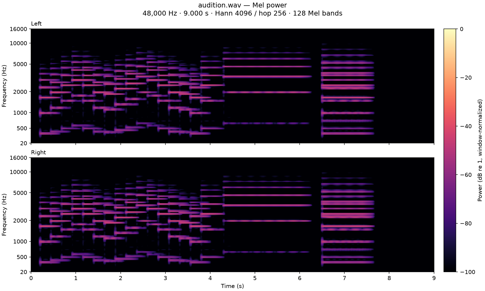
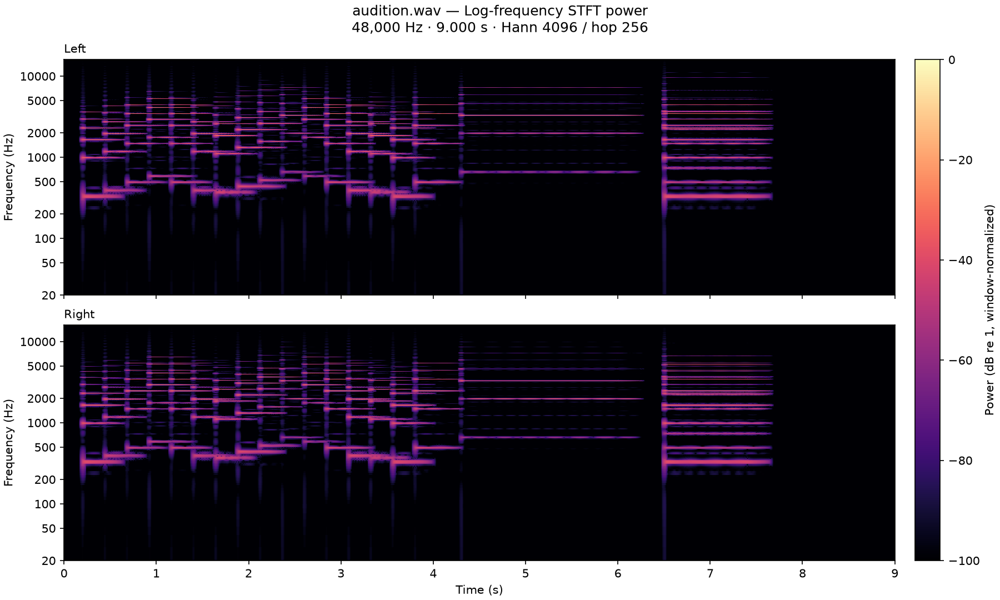

# Gleissendes Licht

A dazzling metallic melody voice with a sharp attack, strong upper harmonics,
and a rippling spectrum over a quiet fundamental. Saved in the local Orchestron
library as **Gleissendes Licht**, type **Melody**.

- [Portable instrument](../../examples/instruments/Gleissendes_Licht.orch.instrument.json)
- [Nine-second melody preview](audition.wav)
- [Audio validation results](validation.json)
- [Installation record](installation.json)
- [Native export/import verification](round_trip_validation.json)

Start in **C3–C6 (MIDI 48–84)**. Playing harder increases both volume and bite.
The instrument is polyphonic, with a fresh attack for every note. Route its
Stereo Output through the performance mixer to Master. The output is centered;
there are no built-in delay or reverb effects.

| Control | Range | Default | Use |
| --- | --- | --- | --- |
| Brilliance | 1.4–4.8 | 2.8 | Increase upper-harmonic density and metallic edge |
| Motion | 0–0.65 | 0.36 | Increase the shimmering movement of the overtones |
| Release (s) | 0.06–0.9 | 0.26 | Shorten for fast phrases or lengthen for ringing notes |

Controls are independent per rack instance and apply to new notes.

## Sound design

A single carrier/modulator FM pair uses a 3:2 frequency ratio. A separate sine
anchors the played pitch. The FM branch passes through a high-pass filter at
1.7 times the note frequency before the sine is mixed in. Two slow oscillators
(3.7 Hz and 0.43 Hz) vary FM depth, and a short exponential contour adds attack
bite. Pitch tracking reduces modulation depth in the upper register.

The amplitude envelope is 6 ms attack, 240 ms decay, 72% sustain, and a
260 ms default release. A 13.5 kHz low-pass filter rounds the highest partials;
output gain leaves headroom for the tested four-note chords.

## Validation

Backend compilation succeeded without diagnostics. The saved graph and native
import preview preserve the Melody type, Stereo Output, formulas and controls.
Fifteen rendered scenarios cover default settings, each control's minimum and
maximum, and all eight combinations of control extremes. Each includes four
velocities, low/high notes, retriggers, a sustained note and a four-note chord.

All samples were finite, both channels matched, velocity response increased,
and tails reached silence. Maximum peak across the suite was 0.76248
(approximately −2.36 dBFS). On the default sustained E4, energy above 1.5 times
the fundamental exceeded the fundamental band by **15.50 dB**. Overlapping notes
matched the sum of independently rendered voices.

Both Mel and log-STFT images were opened and visually inspected for the preview,
default suite and six individual control extremes. They show stable harmonic
pitch, stronger high partials at higher Brilliance, periodic amplitude changes
with Motion, matching channels, and the expected release lengths into silence.
The eight combined extremes were checked numerically. Actual listening by the
agent was not performed; the preview is available for subjective evaluation.

The frontend production build, Docker `frontend-build` target and whitespace
checks passed. Existing examples and the raw drumkit build input were preserved.

## Reproduce

From the repository root with its Python dependencies, Csound and FFmpeg:

```sh
.venv/bin/python tools/gleissendes_licht/build.py
.venv/bin/python tools/gleissendes_licht/validate_audio.py
```

The validation suite writes comparison recordings to
`/tmp/orchestron-gleissendes-licht-validation/`. `render.py` preserves the
compiler's canonical score and uses isolated MIDI rendering through the mixer.
It does not start or modify live playback.

For a library that does not already contain the name, use
`build.py --install`. Installation refuses to overwrite an existing instrument.

Generate the final spectrograms with the patch skill's `render_spectrograms.py`,
using FFT 4096, hop 256, 128 Mel bands, 20–16000 Hz and fixed −100–0 dB limits.
Open both views after numerical validation.




