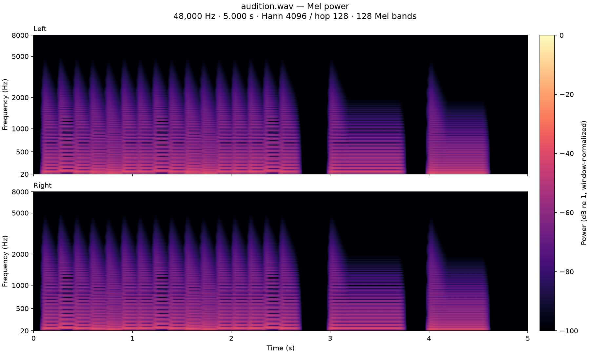
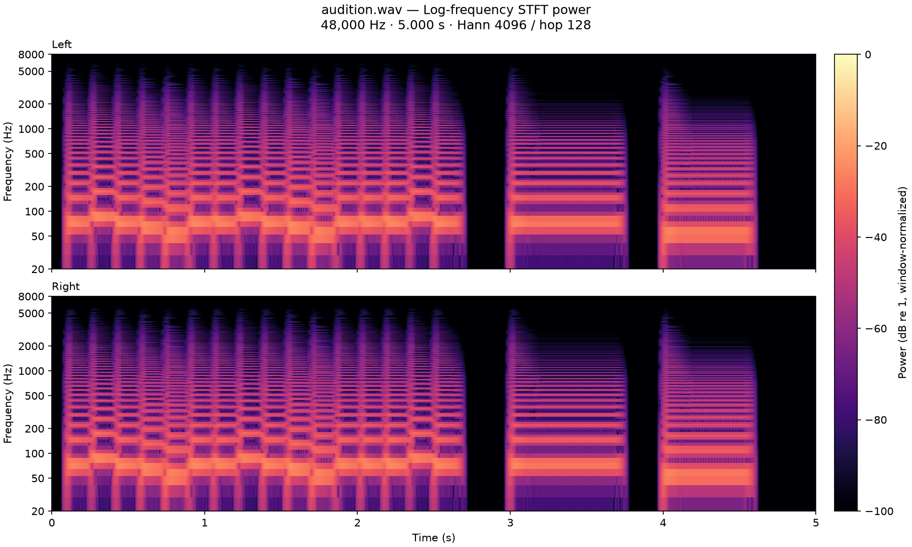

# Synth Bass

A dry, velocity-sensitive synth bass reconstructed from the harmonic structure
of the supplied mobile recording. The instrument is synthesized entirely with
oscillators and filters; the recording is not sampled or distributed.

Installed in the local Orchestron library as **Synth Bass**, type **Bass**,
patch ID `c3d19531-a832-4e4f-b99e-c9cf62fe6de4`.

- [Native instrument export](../../examples/instruments/Synth_Bass.orch.instrument.json)
- [Five-second audio preview](audition.wav)
- [Numerical audition report](validation.json)
- [Export/import preview verification](round_trip_validation.json)
- [Reference comparison](reference_comparison.json)

## Sound and playing

The signal path is a MIDI-pitched `vco2` saw, `moogladder2` low-pass filter,
compensated `distort1` saturation, centered `pan2`, and one mapped Stereo Output.
Route Stereo Output through the performance mixer to Master.

Amplitude ADSR is 2 ms / 110 ms / 60% / 45 ms. An independent exponential
filter envelope falls from 3000 Hz to 900 Hz over 180 ms, then explicitly holds
900 Hz until note release. The 0.2 filter resonance adds a small amount of bite.
Every MIDI note starts its own voice and envelopes, including overlapping notes;
there is no legato mode, glide, or octave transposition. Start around MIDI 33–41
(A1–F2); the suggested playing range extends to MIDI 53 (F3).

| Control | Stable node ID | Range | Default |
| --- | --- | --- | --- |
| Tone | `bass_tone` | 0.5–2× filter brightness, logarithmic | 1× |
| Decay (s) | `bass_decay` | 0.04–0.30 s, logarithmic | 0.18 s |
| Drive | `bass_drive` | 1–3, linear | 1.2 |

Controls apply to new notes and are independent for each performance instance.
Drive uses `distort1` mode 2 with zero shape parameters and reciprocal gain
compensation, retaining gentle saturation at the default. See the
[Csound opcode reference](https://csound.com/docs/manual/distort1.html).

## Matching the reference

The supplied recording contains a repeating low-register phrase, sharp onsets,
and strong low/mid harmonics. Phone, speaker and room response obscure the exact
source spectrum, so the reconstruction targets the musical character rather than
the recording noise or room resonances.

Eighteen filter candidates were compared using harmonic peaks in three short
reference segments (approximately F2, C2 and A1). The comparison subtracts a
local spectral background, normalizes low harmonics, and caps individual errors
to reduce the influence of room notches. Several candidates were nearly tied;
3000→900 Hz over 180 ms retains the darker sustained body while allowing the
bright attack to last through short notes. The numeric error is a tuning aid,
not a perceptual similarity rating. The preview phrase is approximate, not an
exact transcription.

## Reproduce

Run from the repository root with the repository's backend dependencies and
Csound installed. `ffmpeg` writes the floating-point WAV files.

```sh
.venv/bin/python tools/synth_bass/build.py
.venv/bin/python tools/synth_bass/validate_audio.py
```

`base_spec.json` supplies the patch creator CLI's base graph. `build.py` adds the
independent filter envelope, three stable performance controls, formulas and
layout; `patch.json` is the resulting full API payload. The authoring scripts use
the repository's patch CLI and compiler without modifying application code.

Optional reference comparison, using the original private recording:

```sh
.venv/bin/python tools/synth_bass/compare_reference.py "/path/to/reference.m4a"
```

After numerical checks, generate the final images with the patch skill's audio
dependencies, then open both views for visual inspection:

```sh
MPLCONFIGDIR=/tmp/synth-bass-mpl \
  integrations/skills/orchestron-patch-creator/.venv/bin/python \
  tools/synth_bass/spectrograms.py
```

The preview and its images stay here. Fifteen full validation auditions, their
images and comparison contact sheets are written under
`/tmp/orchestron-synth-bass-validation/`. These renders do not use live sessions.
The analyzer uses 48 kHz, Hann FFT 4096, hop 128, 128 Mel bands, 20–8000 Hz, and
fixed −100–0 dB spectral color limits across every render.

On a library where **Synth Bass** does not already exist, install with:

```sh
.venv/bin/python tools/synth_bass/build.py --install
```

This compile-preflights in a temporary session, creates a new patch through the
API, and exports it. It refuses to replace an existing instrument. Normal import
of the native export is also available through Orchestron's Instrument Design UI.

## Validation

- Local MIDI audio render and running-backend compile both passed; backend
  diagnostics were empty.
- Fifteen scenarios cover default settings, each control's minimum/maximum and
  all eight combinations of control extremes. Each includes velocities
  32/64/100/127, low/high notes, held notes, rapid retriggers and overlapping notes.
- All samples were finite. Maximum peak across the suite was **0.52293
  (−5.63 dBFS)**, including a three-note chord at maximum velocity.
- Both channels produced equal audio, velocity response increased monotonically,
  and release tails reached silence. Tone and Decay produced the expected
  brightness changes. Overlapping notes exactly matched the sum of independent
  fresh attacks in the deterministic renderer.
- Native export/import preview preserved the graph, Bass type, three controls
  and Stereo Output. The existing live session snapshot was unchanged.
- Frontend production build, Docker `frontend-build` target and whitespace checks
  passed. The frontend reported its existing large-chunk advisory.
- Both Mel and log-STFT views were generated for all 16 auditions. The preview,
  default suite and six individual-control extremes were opened and inspected.
  They show fresh bright attacks, stable held-note harmonics, the expected Tone
  and Decay changes, matching channels and releases into silence. No unexpected
  persistent tones or broadband bursts were seen outside note attacks. The eight
  combined-control corners were numerically checked but not individually viewed.
- Actual listening by the agent was not performed; the WAV is provided for
  subjective comparison with the reference.

### Final spectrograms




